# VendurePOS against WCPOS 2.0.0: parity audit

Read on 2026-11-10.
- **Target:** WCPOS 2.0.0, `~/Projects/monorepo` branch `main` at `5ac185b0e` (`apps/main` 2.0.0, shipped 9 Nov).
- **This app:** vendurepos/app `main` at `677fd38`, `@tallyui/*` 3.9.1 (npm `latest` is 3.12.0), plugin `packages/vendure-plugin`.
- **Supersedes** the area tables of `docs/V2-PARITY.md`, which was read against the wiki on 2026-10-06. That file's Vendure-way notes (channels, promotions, roles) still hold.

Parity means the core features a Vendure merchant expects, built Vendure's way (Paul, 2026-10-07). It does not mean copying WooCommerce's mechanisms: where v2's feature is WooCommerce's own, the row says N/A.

**Key**
- **Status:** Present, Partial, Missing or N/A, for this app against v2.
- **Gap owner:**
  - **app:** `apps/pos` only.
  - **plugin:** `packages/vendure-plugin`, this repo's connector backend.
  - **shared:** a TallyUI package, named with the function needed. `@tallyui/connector-vendure` is a TallyUI package, so a change there is shared too.
- **Already shipped in 3.9.1:** a shared piece that is published but that the app does not use yet. Gaps that rest on one of these are app-local.

v2 paths below are under `monorepo/`; "core" means `packages/core/src`.

## Summary

| Area | Status | Gap owner |
|---|---|---|
| 1. Redrawn UI: area navigation | Partial | shared (`@tallyui/components` app shell), app routes |
| 2. Theme, Scale, Fonts, Icons settings | Missing | shared (`@tallyui/theme`); app for system dark mode |
| 3. Tender pane, split payments | Partial | shared (`@tallyui/components` `SplitTender`) |
| 4. Registers: float, pay in/out, count, numbered closures | Present (gaps: X report, closure history, approval) | app, plugin |
| 5. Offline cash sales and outbox | Present (gap: discard a rejected sale) | app |
| 6. Reports | Missing | app + plugin |
| 7. Refunds | Partial: store side done, no till UI | app (shared pieces shipped) |
| 8. Customer display | Missing | shared + plugin |
| 9. Card readers | Missing | shared + plugin |
| 10. Sync and store health | Partial | app |
| 11. Settings | Partial | app, shared |
| 12. Receipts and printing | Partial | plugin + app (email), shared (templates, ESC/POS) |
| 13. Cart: open orders, notes, coupons | Partial | shared + plugin |
| 14. Products: grid, variants, filters | Partial | app (tile size), shared (filters) |
| 15. Barcode and camera scanning | Partial | app |
| 16. Product management (stock, price) | Missing | plugin + shared |
| 17. Orders screen | Partial | app |
| 18. Customers screen | Missing | app |
| 19. Coupons screen | N/A | — |
| 20. Cashier, register, store switching | Partial | shared + plugin |
| 21. Keyboard shortcuts | Missing | shared |
| 22. i18n | Missing | shared |
| 23. Auth, onboarding, gates | Present | — |
| 24. Support, notifications | Missing | app |

## Areas in detail

### 1. Redrawn UI: area navigation
- **v2:**
  - The drawer lists POS, Products, Orders, Coupons, Customers, Reports, Store health (with an unread-error badge), Settings and Support.
  - Phones get a front drawer; wide screens get an icon rail sized by Scale.
  - Paths: `apps/main/app/(app)/(drawer)/_layout.tsx`, `apps/main/components/area-navigation/`.
- **Here: Partial.**
  - Three routes: `apps/pos/app/index.tsx` (the till), `apps/pos/app/settings.tsx` and `apps/pos/app/sign-in.tsx`.
  - Orders and Register are panels inside the till's header. Wide and phone layouts exist (`WIDE_MIN_WIDTH`).
  - The header colour (`#fff`) and `StatusBar style="dark"` are hard-coded in `apps/pos/app/_layout.tsx`.
- **Gap:**
  - **shared:** `@tallyui/components` needs an `AppShell`/`AreaNav` (drawer on phones, rail on wide screens, item badges), so every platform app gets the same redraw.
  - **app:** the area routes themselves (Orders, Customers, Reports, Health), which can land now as plain stack routes and move into the shell when it ships.

### 2. Theme, Scale, Fonts, Icons
- **v2:**
  - Settings › Theme holds four settings, saved per device:
    - 10 themes (System, Light, Dark, Ocean, Sunset, Monochrome, Paper, Warm, Bold, Market).
    - Scale: Auto, Compact, Regular or Spacious.
    - Icons: Auto, Tabler, Hugeicons or Phosphor.
    - Fonts: Auto, System, Instrument, Grotesk, Fraunces or Manrope.
  - Path: `core/screens/main/settings/theme.tsx`. Keys: `theme`, `scale`, `icons`, `fonts`.
- **Here: Missing.**
  - `@tallyui/theme` 3.9.1 `tokens.css` has a `@variant dark` block, but the app pins a light header and status bar.
  - `apps/pos/app.json` has no `userInterfaceStyle`.
- **Gap:**
  - **app:** follow the system light/dark scheme (header and status bar from tokens, `userInterfaceStyle: automatic`). This works with what is shipped.
  - **shared:** `@tallyui/theme` needs:
    - named theme sets beyond light and dark;
    - a scale token set with a `ScaleProvider` (Compact, Regular, Spacious, Auto by width);
    - font pairings with a loader;
    - an icon-set switch in `@tallyui/components` `Icon`.
  - **app:** then a Settings › Theme group.

### 3. Tender pane, split payments
- **v2:**
  - A tile grid of methods and a keypad.
  - Quick chips: Exact, Full balance, Take N.
  - Change due, and cash rounding.
  - Part payment, with a list of payments taken.
  - Split evenly, by amount, by percent or by item; a short payment moves to the next one.
  - Cancelling voids the payments already taken.
  - Path: `core/screens/main/pos/checkout/`.
- **Here: Partial.**
  - `apps/pos/lib/sale-tender.tsx` has cash with quick amounts (`CashTendered`) and change (`ChangeDisplay`), and card as an external payment confirmed by hand.
  - `SplitTender` (`@tallyui/components`) splits between cash and card.
  - The plugin applies split sales as several payments (order.create v5).
  - E2E: "a demo cashier splits a sale between cash and card"; "a split sale, part cash and part card, is applied by the plugin with both payments".
- **Gap: shared.** `@tallyui/components` `SplitTender`/`Tender` needs split by percent and by item, the payments-taken list, and void-on-cancel. `@tallyui/pos` `tenderReducer` needs cash rounding. Nothing app-local.

### 4. Registers
- **v2:**
  - Opening:
    - Bind a register ("Which register is this device at?").
    - Open with a float, with chips for the default float and the last count.
  - During the shift:
    - Paid in, Paid out and No sale, with reason chips, undo and retry.
    - X report and a hand-over slip.
  - Closing:
    - A count by denomination, plus the other tenders counted per method.
    - Short / Over / Exact, with a note.
    - Warnings about unsynced sales and open carts.
    - An overdue-close prompt.
  - Approval: a manager approves an over-limit variance with WordPress credentials.
  - Closures:
    - Numbered closures and a Z report, with period and perpetual totals.
    - Blind counting.
    - "Take the drawer with you".
- **Here:**

| Item | Status | Where / gap |
|---|---|---|
| Open with float, pay in/out, void a movement | Present | `OpenRegisterCard`, `RegisterPanel`, `MovementSheet`; plugin `register.entities.ts`; e2e "a register day: open with a float, sell, move cash, count and close; the Z report and the plugin agree" |
| Count by denomination, numbered closures, Z report and print | Present | `RegisterCount`, `ClosureSheet`, `apps/pos/lib/z-report.ts` |
| Close waits for unsynced sales | Present | `apps/pos/lib/closure-hold.ts`; e2e "a closure waits for its session's orders" |
| Resume a lost till, take-over | Present | `apps/pos/lib/register-conflict-card.tsx`, ADR 0006 |
| X report mid-shift | Missing | **app**: `buildXReportDocument` ships in `@tallyui/pos` 3.9.1, unused |
| Closure history and Z reprint | Missing | **app**: this till's closures are in the local closure collection (`selectClosureRows` ships). **plugin**: a read route (`GET /tally/v1/registers/:id/closures`) for closures from other tills |
| Manager approval checked by the server | Partial | Typed name only (`apps/pos/lib/typed-approval.tsx`). **plugin**: an approval route checking `ApproveTallyPosVariance` against a Vendure admin's credentials (medusapos ADR 0023's shape). **shared**: an approval field in `@tallyui/core`'s register close contract |
| Blind counting, overdue-close prompt, take the drawer, hand-over slip | Missing | **shared** (`@tallyui/pos` session rules, `@tallyui/components` `RegisterCount`), then **plugin** (blind-count setting per register) |

### 5. Offline cash sales and outbox
- **v2:**
  - Asks "Take N in cash while offline?".
  - Tender tiles are marked "Sent later" or "Store may refuse".
  - Orders › Needs attention.
  - Store health › Database lists held conflicts and rejected changes, each with send again or discard.
- **Here: Present.**
  - `useOrderOutbox` and `useRegisterOutbox` from `@tallyui/pos`.
  - The Orders panel retries stuck orders; refused batches have "Send again"; the header shows "n needs attention".
  - E2E: "25 sales, 20 offline: 25 orders, none duplicated, at the POS totals, settled, fulfilled, and the stock drops" (`offline.spec.ts`); "a rejected sale needs attention, is retried from the Orders panel and applies; a refused batch is sent again".
- **Gap:** discarding a rejected sale (with a confirmation that says the money is not recorded) is **app**, if `OrderOutbox` exposes removal; otherwise **shared** `@tallyui/pos` `OrderOutbox.discard(id)`.

### 6. Reports
- **v2:**
  - One Reports screen with panels: orders, payments by method, top products, categories, cashiers, taxes, refunds, registers.
  - Stats: net sales, average order, and similar. Charts by hour or day, with comparisons.
  - Filters: date range, register, cashier.
  - A Closures tab with closure detail. Print, and CSV export.
  - Path: `apps/main/app/(app)/(drawer)/reports/index`.
- **Here: Missing.** Only the Z print.
- **Gap:**
  - **plugin:** a `GET /tally/v1/reports/sales?from&to&register` route that totals the channel's POS orders in SQL. Vendure's admin API paginates orders, so totalling on the till does not scale past a day.
  - **app:** a Reports route showing the totals, with `exportCsv` (ships in `@tallyui/pos` 3.9.1).
  - **shared, later:** charts in `@tallyui/components`.

### 7. Refunds
- **v2:**
  - A refund modal from Orders, with a quantity per line, a custom amount and a reason.
  - Refund via cash or to the original gateway.
  - Shows earlier refunds, needs a connection, guards against refunding twice, and prints a refund receipt.
  - Path: `orders/(modals)/refund/[orderId]`.
- **Here: Partial.**
  - Store side done:
    - `packages/vendure-plugin/src/service/refund.service.ts` applies `order.refund` v1 as Vendure's `refundOrder`.
    - It is gated by `TallyPosRefund`, needs an open session, and refuses a duplicate `clientRefundId`.
    - Tests: `e2e/order-refund.e2e.ts`, `e2e/refund-contract.e2e.ts`.
  - No till UI.
- **Gap: app.** Everything the till needs ships in 3.12.0 (correction: 3.9.1 lacks `OrdersList onOpen` and `vendureLineRefundWithTax`, so the bump comes first):
  - `getVendureOrder` and `vendureRefundable` (`@tallyui/connector-vendure`);
  - `submitOrderRefund`/`sendOrderRefund` and `posRefundCollection` (`@tallyui/pos`);
  - `OrderDetail` (`@tallyui/components`).
  - Register figures already count applied refunds (`deriveExpected`, `writeClosure`).
- **Next unit.**

### 8. Customer display
- **v2:**
  - Settings › Customer Display: pair a second device by code; a list of paired displays.
  - The display shows the cart and "Payment declined".
  - Paths: `core/screens/main/settings/customer-display/`, `core/services/customer-display`.
- **Here: Missing.**
- **Gap:**
  - **shared:** a display transport and display screen (`@tallyui/pos` `CustomerDisplaySource`, `@tallyui/components` `CustomerDisplay`).
  - **plugin:** a pairing relay route.
- A same-device second window would be app-local, but it does not match v2's paired device, so it waits for the shared design.

### 9. Card readers
- **v2:**
  - Smart readers, Tap to Pay, and Bluetooth readers, with firmware and battery shown.
  - A driver registry keyed by `capture.provider`: Stripe Terminal, SumUp, and a simulated driver.
  - Path: `core/services/payment-drivers/`.
- **Here: Missing.** Card is recorded as an external payment.
- **Gap:**
  - **shared:** `@tallyui/pos` payment-driver registry and terminal state machine.
  - **plugin:** a Vendure `PaymentMethodHandler` per provider, with the authorized/settled split, which is Vendure's own way.

### 10. Sync and store health
- **v2:**
  - Store health › Database: coverage on device vs on server, "Check for changes now", "Clear & re-download", held and rejected changes.
  - Store health › Logs: presets, copy and share.
  - Performance: cadence presets.
  - A drawer badge counts unread errors.
- **Here: Partial.**
  - `SyncStatus` shows only while sales are pending.
  - The catalogue re-pulls every 60 s and on focus or coming online (`apps/pos/lib/catalogue.ts`), with ID, price and stock reconciles.
  - Logs go to the console only, warn and error (`apps/pos/lib/logging.ts`). Yet `apps/pos/lib/register-sync.ts` tells the cashier to "look at the till's sync log", which does not exist.
- **Gap: app.**
  - A "Sync now" control with a last-synced time.
  - A log viewer fed by an in-memory ring sink (`callbackSink`/`LogSink` ship in `@tallyui/pos`).
  - A Store health route (outbox counts, storage health, a re-download).
  - **shared, later:** cadence presets.

### 11. Settings
- **v2 groups:**
  - General: name, locale, default customer, number format.
  - Tax: display, tax rates.
  - Printing: printer profiles, templates, auto print and show.
  - Card readers; Customer display.
  - Barcode scanning: min length, timing, prefix/suffix, sounds, scanner test.
  - Theme.
- **Here (`apps/pos/app/settings.tsx`):**
  - Scanner shortest code.
  - Register approval threshold.
  - Price changes on/off.
  - Default customer.
  - Print after each sale (web).
  - Barcode field (read-only).
- **Gaps:**
  - **app:**
    - prefix/suffix and timing (the wedge scanner is the app's own, `apps/pos/lib/use-wedge-scanner.ts`);
    - scan sounds;
    - tile size (`gridColumns` in `@tallyui/pos` catalogue view state);
    - a tax rates list (from `TaxProvider`);
    - follow system dark mode.
  - **shared:** theme, scale and fonts (area 2), printers (area 12), language (area 22).
  - **N/A:** WooCommerce-only settings: number format, tax display flags, cashier as the default customer. See `docs/V2-PARITY.md`, "Settings, one by one".

### 12. Receipts and printing
- **v2:**
  - Receipt modal: template and printer pickers, zoom, print and reprint, PDF, email (queued offline), fiscal status, refund receipt.
  - ESC/POS printers (Epson, Star) over network, USB or Bluetooth; cash drawer kick; cloud printing.
  - Templates for receipt, report and closure.
  - Path: `packages/printer`.
- **Here: Partial.**
  - On-screen receipt (`apps/pos/lib/sale-receipt.tsx`).
  - Browser print and auto-print (`apps/pos/lib/print-lines.ts`).
  - Z print.
- **Gap:**
  - **plugin + app:** an email receipt. A `POST /tally/v1/orders/:code/receipt-email` route on Vendure's `EmailPlugin`, plus a Send button. POS orders are kept out of the confirmation email today (`packages/vendure-plugin/src/email.ts`).
  - **app:** a reprint from an order row.
  - **shared:** a printer package (`@tallyui/printer`: ESC/POS encoders, printer profiles, drawer kick) and receipt templates.

### 13. Cart
- **v2:**
  - Open orders as tabs, scoped by cashier and register; hand an order to another cashier or register.
  - Fee, shipping and misc product; percent or fixed discount; quick discount keys.
  - Coupons; tax exempt; order note and meta; void.
- **Here: Partial.**
  - Park and resume.
  - Line and order discounts.
  - Line price edit.
  - Fees, one shipping line and custom items (order.create v5).
  - E2E: "a discounted sale"; "fees, a shipping charge and a custom item…".
- **Gap:**
  - **shared:** several open orders in `@tallyui/pos`'s order manager, with a tab strip in `@tallyui/components`.
  - **shared + plugin:** an order note. `CartNoteInput` ships, but order.create v5 has no note field: it needs an order.create v6 `note` in `@tallyui/core`, and the plugin must apply it as a Vendure order note.
  - **plugin + shared:** coupons, i.e. Vendure promotions on POS orders (off by ADR 0002, so a contract question first).
  - **shared:** quick discount keys (`DiscountForm` presets).

### 14. Products: grid, variants, filters
- **v2:**
  - Grid/table; tile size and tile fields.
  - Variations shown in place, in a popover or as rows.
  - Categories, tags, brands; a customisable filter bar with saved filters.
  - In-cart count and stock on each tile.
- **Here: Partial.**
  - `Catalogue` with category nav and a grid/table toggle; a tile opens its variant buttons.
  - E2E: "a demo cashier picks a category, still scans a product from another, and switches the products to a table".
- **Gap:**
  - **app:** a tile-size setting through `gridColumns`.
  - **shared:** facet filters. `@tallyui/components` `Catalogue` needs facet filter chips (`FilterChip` ships), and `@tallyui/connector-vendure` must expose the synced `facetValues` as filters. Also saved filters.

### 15. Barcode and camera scanning
- **v2:**
  - Wedge scanner: min length, timing threshold, prefix/suffix, a scanner test.
  - Camera scan; direct BLE/HID scanners.
  - Sounds and haptics.
- **Here: Partial.**
  - Wedge scan with a minimum length and a barcode field (`docs/scan-policy.md`).
- **Gap: app.**
  - Prefix and suffix settings.
  - Scan sounds (a hit and a miss).
  - Camera scan (`expo-camera` on native, `BarcodeDetector` on web), fed into the existing scan handler.
  - **shared, later:** direct BLE scanners.

### 16. Product management
- **v2:** edit a product's or variation's stock, price and cost (Pro).
- **Here: Missing.**
- **Gap:**
  - **plugin:** a `stock.adjust` command per stock location (PLAN "M6 proper") and the channel price.
  - **shared:** the command contract in `@tallyui/core`.
  - **app:** a Products route.
- Cost is not a Vendure core field: N/A unless the merchant adds it as a custom field.

### 17. Orders screen
- **v2:**
  - An Orders route: filters, a date range, needs attention.
  - View, edit, receipt and refund modals; re-open into the cart.
- **Here: Partial.**
  - An Orders panel inside the till: the outbox plus the 25 newest store orders (`listVendureOrders`, `apps/pos/lib/order-history.ts`).
  - No detail view, search or paging.
- **Gap: app.** An order detail sheet from a row (`getVendureOrder` and `OrderDetail` ship), which refunds then start from; then search and paging through `listVendureOrders` options.

### 18. Customers screen
- **v2:** list, add and edit customers, with tax IDs.
- **Here: Missing.** Customers can be searched and created from the cart only (`apps/pos/lib/sale-customer.tsx`).
- **Gap:**
  - **app:** a Customers route using `searchVendureCustomers`, `createVendureCustomer`, `CustomerForm` and `CustomerOrderHistory` (all shipped).
  - **shared:** an edit (`updateVendureCustomer` in `@tallyui/connector-vendure`).

### 19. Coupons screen
- **v2:** create and edit WooCommerce coupons.
- **Here: N/A.** Vendure promotions are managed in the Vendure dashboard. Applying them on the till is area 13.

### 20. Cashier, register and store switching
- **v2:**
  - Switch user, register or store from the register panel.
  - Open orders scoped per cashier.
- **Here: Partial.**
  - "Choose another register" rebinds (ADR 0006).
  - A store is a Vendure channel, so changing store means signing in again.
  - No cashier switch: the actor is `tillIdentity` (`apps/pos/app/index.tsx`, "M7").
- **Gap:**
  - **shared:** `@tallyui/pos` actor and cashier switch with per-cashier open orders.
  - **plugin:** a cashier PIN check against Vendure administrators.

### 21. Keyboard shortcuts
- **v2:** focus search, checkout, new / previous / next cart, discount, void, and a help dialog (`core/screens/main/pos/commands`).
- **Here: Missing.**
- **Gap: shared.** A command and hotkey registry in `@tallyui/pos`, so the shortcuts match across apps.

### 22. i18n
- **v2:**
  - i18next with catalogues fetched by version; language follows the store locale.
  - Number formats.
- **Here: Missing.** English throughout; the Z report uses locale `'en'`.
- **Gap: shared.** Most strings live in `@tallyui/components`, which needs a translation provider and string keys first.

### 23. Auth, onboarding, gates
- **v2:** connect by URL, discovery, demo store, WordPress sign-in, several accounts, update gates.
- **Here: Present.**
  - Password or device key (ADR 0004).
  - Sign in again in place.
  - A demo at demo.vendurepos.com.
  - Refusal without TallyPosSell.
- **Gap:** several accounts on one till (**shared**). Low priority.

### 24. Support, notifications
- **v2:** a Support screen, plugin-update and announcement notices.
- **Here: Missing.**
- **Gap: app.** A Support link (docs and the feedback form) in Settings. Plugin-update notices come from `/info` versions.

## Screenshots

See `screenshots/` next to this file.

Captured 2026-11-10. VendurePOS is the live demo (demo.vendurepos.com, 1280×800; phone 390×844). WCPOS v2 has no committed whole-screen screenshots in the monorepo or the wiki, so its column holds only what the repo has: product-grid frame strips, receipt template previews and component-gallery dialogs. A screen-by-screen v2 comparison needs v2 run and captured separately.

| Area | VendurePOS | WCPOS v2 |
|---|---|---|
| Sell screen | 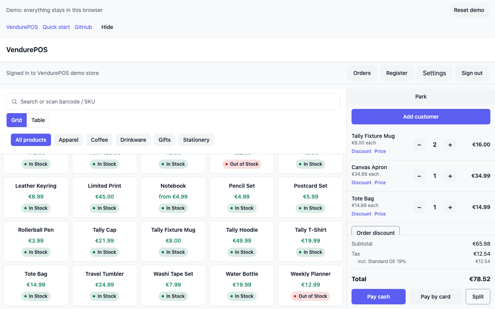 | 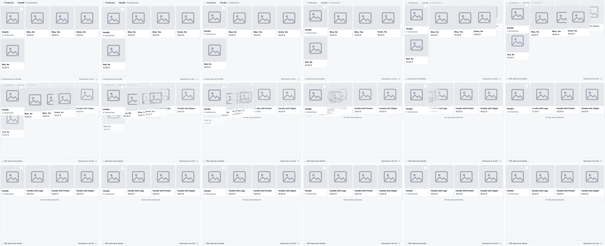 (product pane only) |
| Phone cart | 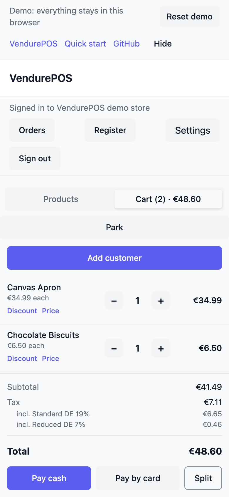 | 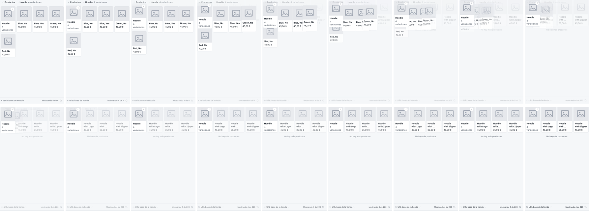 (product pane only) |
| Cash tender | 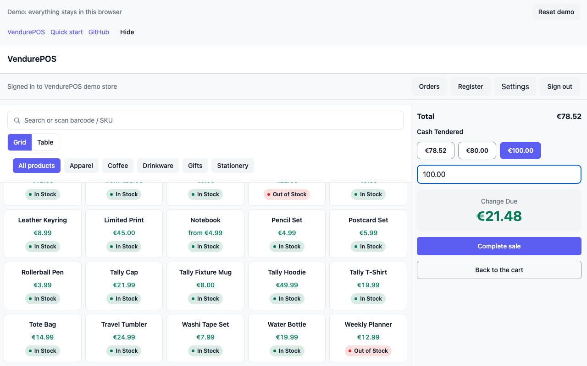 | — |
| Split tender | 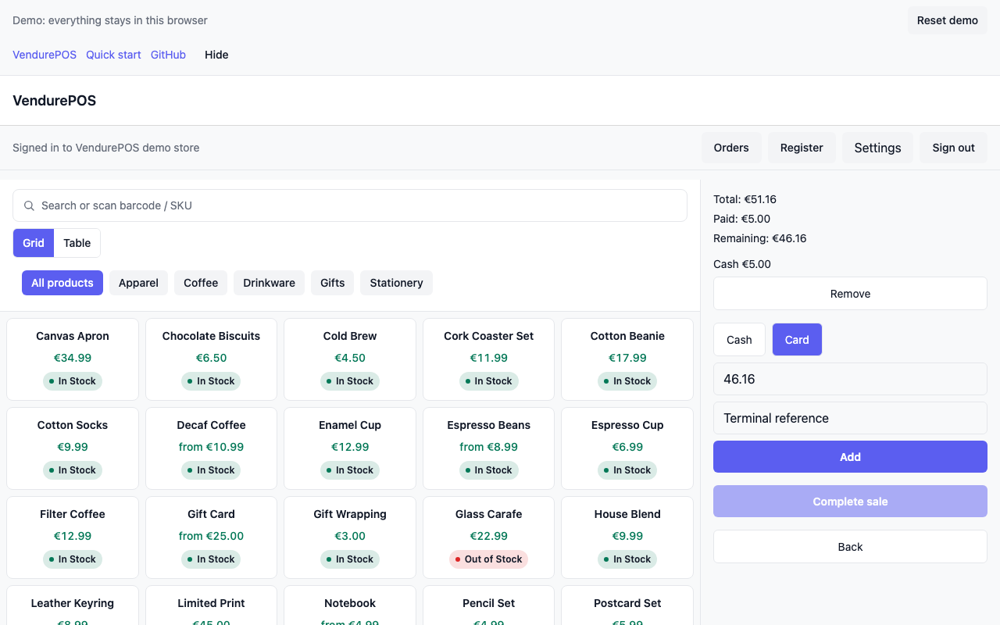 | — |
| Receipt | 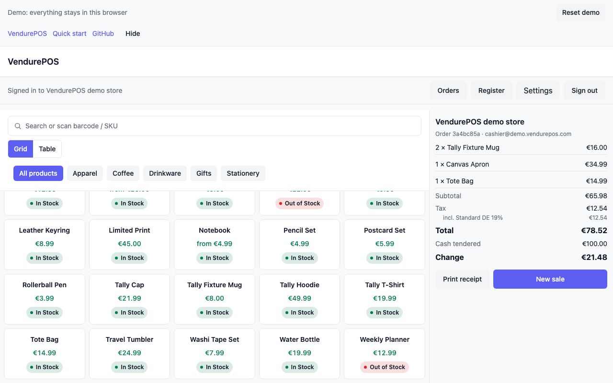 | 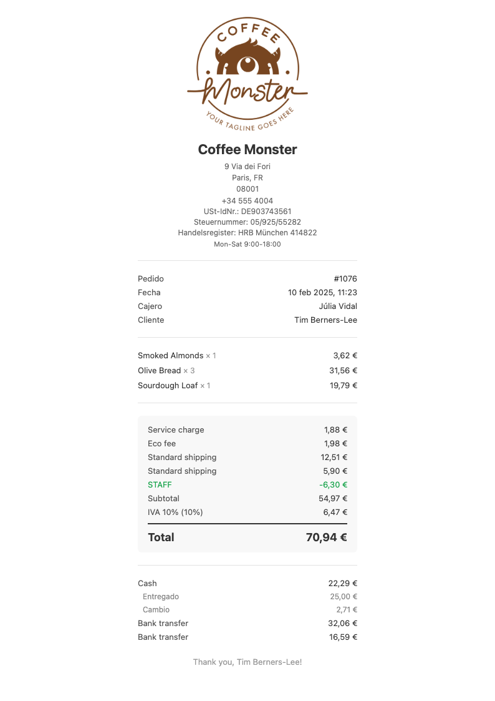 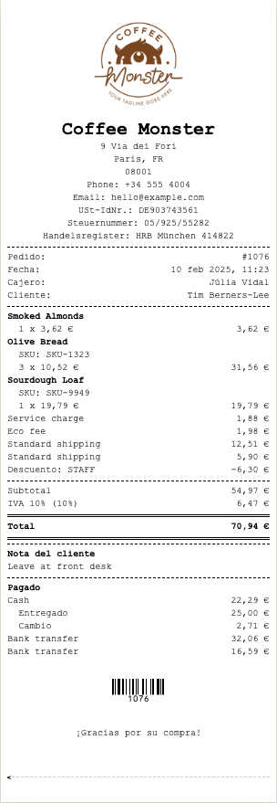 (template previews) |
| Orders | 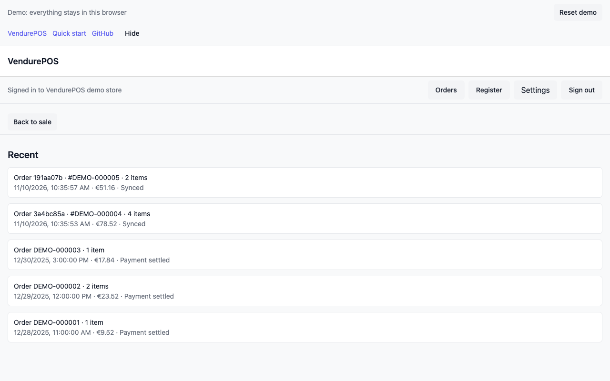 | 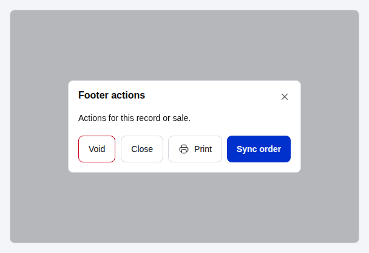 (order dialog footer, gallery) |
| Register panel | 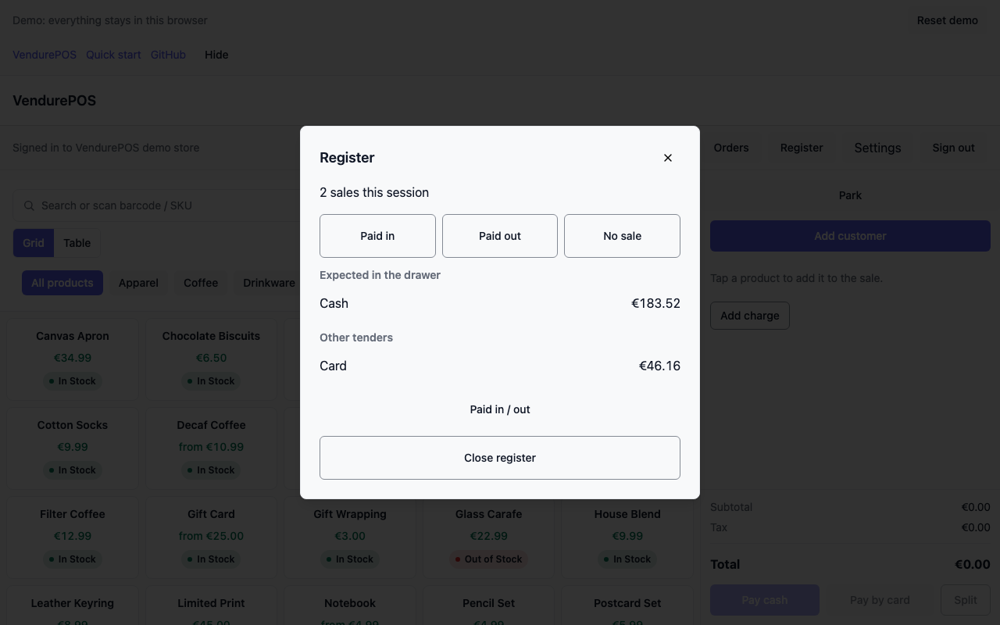 | — |
| Close count | 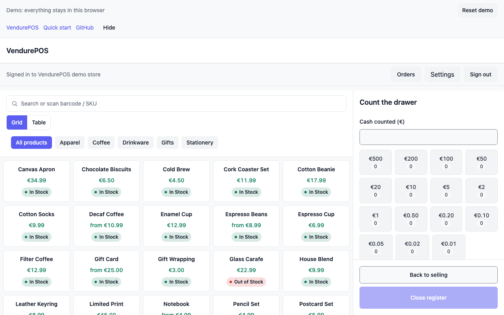 | — |
| Closure / Z | 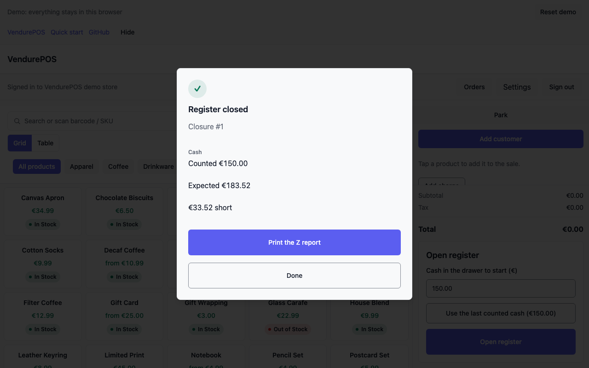 | 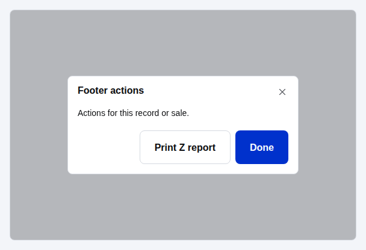 (dialog footer, gallery) |
| Settings | 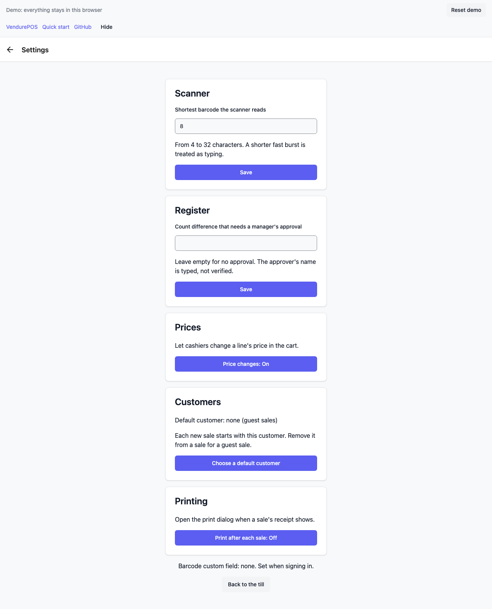 | — |

## What this repo builds next (app-local or plugin, no shared wait)

Ordered top down: money and the cashier's day first.

1. **Order detail from an Orders row** (app). `getVendureOrder` + `OrderDetail`. Needs the 3.12.0 bump first, for `OrdersList onOpen`.
2. **Till refunds** (app). Builds on 1, using the shipped refund pieces. Needs 3.12.0 too, for `vendureLineRefundWithTax`.
3. **X report mid-shift** (app). `buildXReportDocument`.
4. **Closure history and Z reprint from this till** (app). The local closure collection.
5. **Closures read route** (plugin). `GET /tally/v1/registers/:id/closures`.
6. **Sales report route** (plugin), then a **Reports screen** (app).
7. **Sync log viewer and "Sync now"** (app).
8. **Email receipt** (plugin route, then an app button).
9. **System dark mode** (app).
10. **Tile size, scan prefix/suffix, scan sounds** (app settings).
11. **Customers screen** (app).
12. **Camera scan** (app).
13. **The needs-admin queue page in the Vendure dashboard** (plugin).

**Also:** a `@tallyui/*` bump from 3.9.1 to 3.12.0, a deliberate PR of its own. It is checked against the carry-over rules before any unit that needs a newer shared piece.

## Needs from shared packages

Each line names one package and one function. They go to the front desk as one line each.

- `@tallyui/components` `AppShell`/`AreaNav`: drawer and rail with badges.
- `@tallyui/theme` theme sets, `ScaleProvider` (Compact/Regular/Spacious/Auto) and font pairings; `@tallyui/components` `Icon` set switch.
- `@tallyui/components` `SplitTender` by percent and by item, with void-on-cancel; `@tallyui/pos` cash rounding in `tenderReducer`.
- `@tallyui/core` register close contract: a server-checked approval field.
- `@tallyui/pos` `OrderOutbox.discard(id)`, if removal is not exposed.
- `@tallyui/core` order.create v6 `note`.
- `@tallyui/pos` several open orders, and a cashier switch with per-cashier scope.
- `@tallyui/connector-vendure` facet filters; `updateVendureCustomer`.
- `@tallyui/printer` ESC/POS and printer profiles; receipt templates.
- `@tallyui/pos` payment-driver registry (terminals); customer display source and screen.
- `@tallyui/pos` command and hotkey registry.
- `@tallyui/components` i18n provider.
