# VendurePOS against demo.wcpos.com/pos: look-and-function checklist

**Finish line** (Paul, 10 Nov 2026, via the front desk): VendurePOS looks and functions like https://demo.wcpos.com/pos.

This file is the screen-by-screen, flow-by-flow list behind that goal. `AUDIT.md`, next to it, is the code-level audit against WCPOS 2.0.0's source. This list compares the two **running demos** as a cashier sees them.

## How to read this

**Sources**
- Captured 2026-11-10 at 1280×800:
  - WCPOS demo 2.0.0, signed in as demo/demo, store "US Store", register "Front Counter";
  - demo.vendurepos.com, built from `main` at 13:27 UTC.
- The WCPOS demo was only looked at. Nothing was saved, paid or synced, and every order push was blocked before it left the browser.
- The screenshots are in `demo-pairs/`, named `<nn>-<screen>-<wcpos|vendurepos>.webp`. A missing VendurePOS shot means the screen does not exist there.

**Order:** sections and rows follow what a cashier notices first. Section 1 is on screen for every sale; the last section is rarely opened.

**Row tags**
- **Owner** says where the work lives:
  - **app** is `apps/pos`;
  - **plugin** is `packages/vendure-plugin`;
  - **shared** is a TallyUI package, owned by the TallyUI worker and requested through the front desk.
- **Vendure way:** where WCPOS's mechanism is WooCommerce's own, the row asks for the Vendure equivalent (Paul, 2026-10-07). For example, facets stand in for tags and brands, and promotions for coupons.
- `[x]` means a cashier would call it the same. Partly-there rows stay `[ ]`, with the gap named.

**Score:** **21 / 56** rows at parity (round 13, 2026-11-12). The two rows marked N/A are not counted.

---

## 1. Sell screen frame (every sale)

| WCPOS | VendurePOS |
|---|---|
| 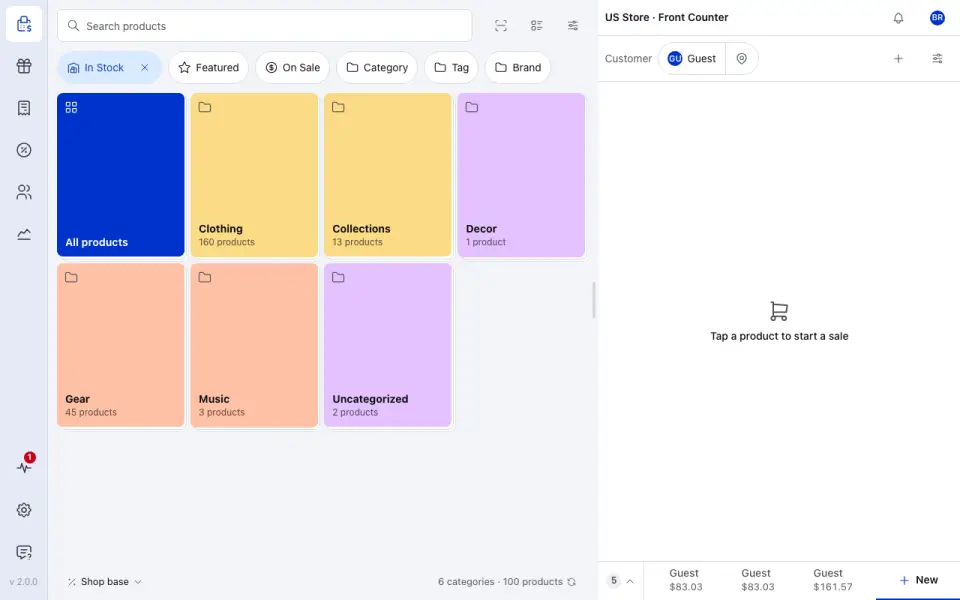 |  |

- [ ] **1.1 Navigation rail.** Wide screens show a left icon rail (POS, Products, Orders, Customers, Reports; Store health, Settings and Support at the foot; the version number), and phones get a drawer. Done (spec B1, TallyUI 3.18.0 `AppShell`): the rail on wide screens and the drawer on phones, with POS, Orders (badged with orders that need attention), Register and Settings. Support is at the foot too (11.2, spec B11), and Reports follows Orders (8.1, spec B13). *Left:* Products, Customers and Store health have no screens in VendurePOS yet, and the rail shows no version number (the Support sheet does).
- [x] **1.2 Compact header.** One slim bar reading "Store · Register", with a bell and the cashier's avatar. Done (spec B1): one `RegisterBar` row (the name, the register pill, the signed-in store, last synced and Sync now on wide screens, the Register door, the avatar); the avatar opens a cashier sheet with Closures and Sign out (the X report moved to the register panel, 6.2); the demo banner is one slim row. A single-register store shows no register name, as in v2. No bell: VendurePOS has no notifications yet.
- [x] **1.3 Product images on tiles.** *App/shared:* the Vendure connector needs `featuredAsset`, and the tile needs an image slot. Done (checked in round 7, no code change): TallyUI's `Catalogue` grid tile renders the product image, the Vendure connector reads `featuredAsset` and then `assets[0]`, and the till's CSP allows `https:` images. On demo.vendurepos.com on 2026-11-12, 30 of 30 tiles showed a loaded picture, at both wide and phone width.
- [x] **1.4 In-cart quantity badge on a tile.** *Shared:* the tile. Done (spec B2): the till passes its cart lines to TallyUI 3.18.0's `Catalogue`, whose grid tiles show the count.
- [ ] **1.5 Browse by category.** Coloured category poster tiles with counts, a breadcrumb ("Categories › All products"), then the products. VendurePOS shows every product, with category chips. *App, Vendure way:* collections.
- [ ] **1.6 Filter pills.** In stock, On sale, Featured, Tag and Brand, with a searchable picker per pill. *Vendure way:* in stock, on sale, plus one pill per facet. *Shared:* `FilterChipGroup` exists in 3.12.0, so the work is the *app* wiring and the facet reads. *Round 7 finding:* TallyUI 3.20.0's `Catalogue` takes `showFilterBar` and `filterChips`, but it applies only the In stock chip itself. It never passes `ProductFilterBar` an `onTermPress`, so the term pills cannot open a picker. Facet pills therefore need a TallyUI change first (shared), and On sale needs a ruling on what "on sale" means for Vendure, which has no compare-at price.
- [x] **1.7 Camera scan button next to search.** Search itself is at parity. *App.* Done (spec B6): on web the Products search has TallyUI 3.20.0's camera button and inline `CameraScannerPanel`, with a resizable height that is remembered. Every accepted read goes through the same scan handler as a wedge scan (`docs/scan-policy.md`). An item resting in view is added once. The camera is let go while the catalogue is hidden. *Left:* native (iOS/Android) has no camera viewfinder yet, so the button shows on web only.
- [ ] **1.8 "Showing n of N" and infinite load at the foot of the grid.** *App.*
- [ ] **1.9 Grid and table toggle.** Both demos have one, but the columns have not been compared. *App.*

| WCPOS | VendurePOS |
|---|---|
|  | 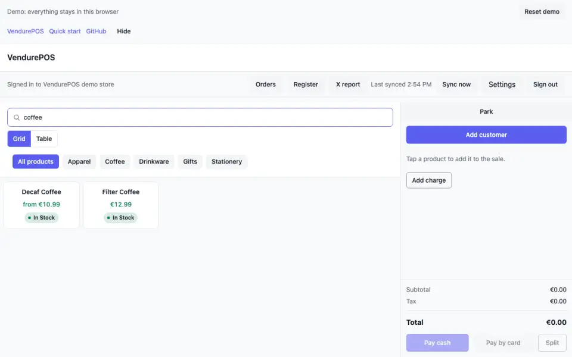 |

## 2. Cart (every sale)

| WCPOS | VendurePOS |
|---|---|
|  | 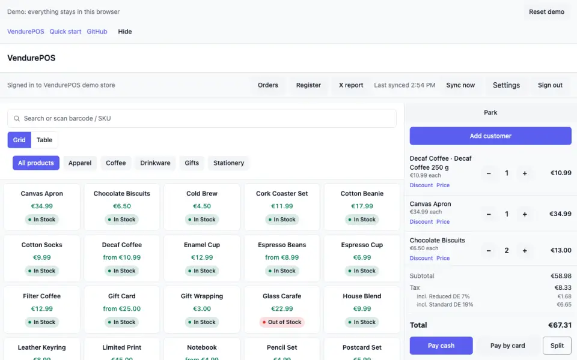 |

- [ ] **2.1 Open carts as tabs.** Every cart stays open by itself, and a strip under the cart shows "Guest $83.03 …", a count and "+ New"; one tap switches. VendurePOS has one sale and an explicit Park dialog. *Shared:* a cart-tabs strip (`ParkedSales` is the closest piece). *App:* several live carts.
- [x] **2.2 One "Checkout €total" button** opening the checkout screen (section 3). Done (spec B3): the cart foot has one "Checkout €total" button in place of Pay cash, Pay by card and Split.
- [x] **2.3 Customer chip in the cart header** ("GU Guest", with an address pin). Done (spec B9): the cart header reads "Customer" and a chip with an initials avatar and the customer's name, or Guest; the chip opens the customer picker and a small × removes the customer (demo e2e "sees Guest in the cart's customer chip"). The address pin opens v2's per-order address editor, so it moves to 5.2. *App.*
- [x] **2.4 Line table with column heads** QTY / ITEM / PRICE / TOTAL. *Shared:* `CartPanel`. Done (spec B2): TallyUI 3.18.0's `CartColumnHeads` and `CartLine` in the till's own cart; the Price column folds on a narrow cart or a phone, as in v2. The price popover followed in spec B4 (2.7).
- [ ] **2.5 Line shows the variant's attributes** ("Size: 32 · Color: Blue") **and a struck-through regular price** on sale items. VendurePOS shows "name · variant" and no regular price. *App/connector.*
- [ ] **2.6 Tap the quantity for a keypad popover** (− / +, 0–9, Done). *Shared:* a keypad popover. Mostly done (spec B2): tapping a line's quantity opens TallyUI 3.18.0's `LinePopover` keypad (0–9, delete, Apply, Cancel), with the line's Discount and Remove as its actions (spec B4). *Left:* the keypad has no − / + keys.
- [x] **2.7 Tap the price for a keypad with quick discounts** (−5 / −10 / −15 %). Done (spec B4): when the till allows price edits, tapping a line's price opens TallyUI's `LinePopover` price keypad. It has v2's −5 / −10 / −15 % quick keys and strikes through the regular price when the line is sold below it. When the Price column folds (narrow cart or phone), Price is an action in the quantity keypad and opens the price form.
- [x] **2.8 Quiet lines.** WCPOS shows Edit / Remove on hover. Done (spec B4): the line shows only quantity, name, price and total. Discount and Remove are actions in the line's quantity keypad, one tap away, the touch-first equivalent of v2's hover (a till tablet has no hover).
- [x] **2.9 Itemised tax lines in the totals.** VendurePOS shows "incl. Reduced DE 7 %" and "incl. Standard DE 19 %", Vendure's way.
- [ ] **2.10 "+" menu:** misc product, fee, shipping, discount, new customer. VendurePOS's "Add charge" covers fee, shipping and custom item. Missing: a percentage fee and an "amount includes tax" switch. *App.*
- [ ] **2.11 Order details dialog:** customer note, tax exempt, void. VendurePOS has only an order discount. *App + plugin* (order note and void).
- [x] **2.12 Toast when an item is added.** Done (spec B9): every add the sale takes, by tap or scan, shows "<item> added to cart" at the top of the till for 2.5 s; a refused add shows none, and the toast never takes a tap (demo e2e "a toast when an item is added"). *App.*

| WCPOS | VendurePOS |
|---|---|
|  | 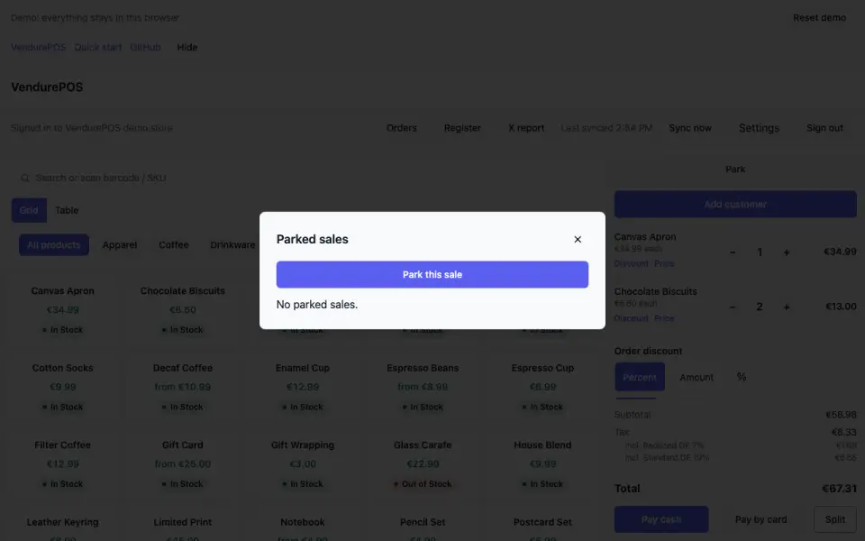 |
|  | 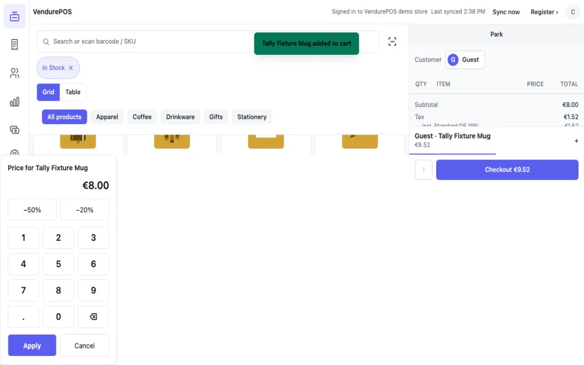 |
|  |  |

## 3. Checkout and tender (every sale)

| WCPOS | VendurePOS |
|---|---|
| 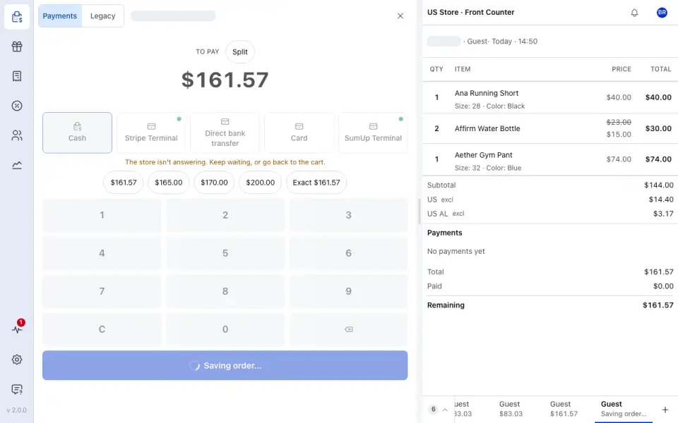 |  |

- [ ] **3.1 Full-screen checkout.** Its parts:
  - "TO PAY €x" with a Split chip;
  - payment-method cards;
  - quick amounts and a numeric keypad;
  - the order summary on the right, with a Payments list and Total / Paid / Remaining.

  Mostly done (spec B3): Checkout opens TallyUI 3.19.0's `TenderPane` in the catalogue's place, with "Remaining €x", method tiles, quick amounts, a keypad and the Payments list; the cart stays on the right, locked, with its totals. On a phone the pane fills the Cart tab. *Left:* the Split chip, and Paid / Remaining sit in the pane rather than in the summary on the right.
- [ ] **3.2 Payment-method list on one screen:** Cash, Card, and the store's other methods. Mostly done (spec B3): Cash and Card terminal are tiles on the one checkout screen. *Left, Vendure way:* the tiles are the till's fixed pair, not the channel's own payment methods.
- [x] **3.3 Split payments shown as a Payments list** with Paid and Remaining. Done (spec B3): each leg is a ledger row (method, amount, Captured, Cancel payment) under "Remaining €x" and "€x of €y paid"; the next leg pre-fills the remaining balance.
- [x] **3.4 Quick cash amounts complete the sale.** Done (spec B3): tapping €50.00 and Take enables Complete sale and shows the change; e2e "a demo cashier pays cash with a quick amount" proves it.
- [x] **3.5 Receipt after the sale** with Print and New sale.

| WCPOS | VendurePOS |
|---|---|
| — |  |
| — |  |

## 4. Variants

| WCPOS | VendurePOS |
|---|---|
| 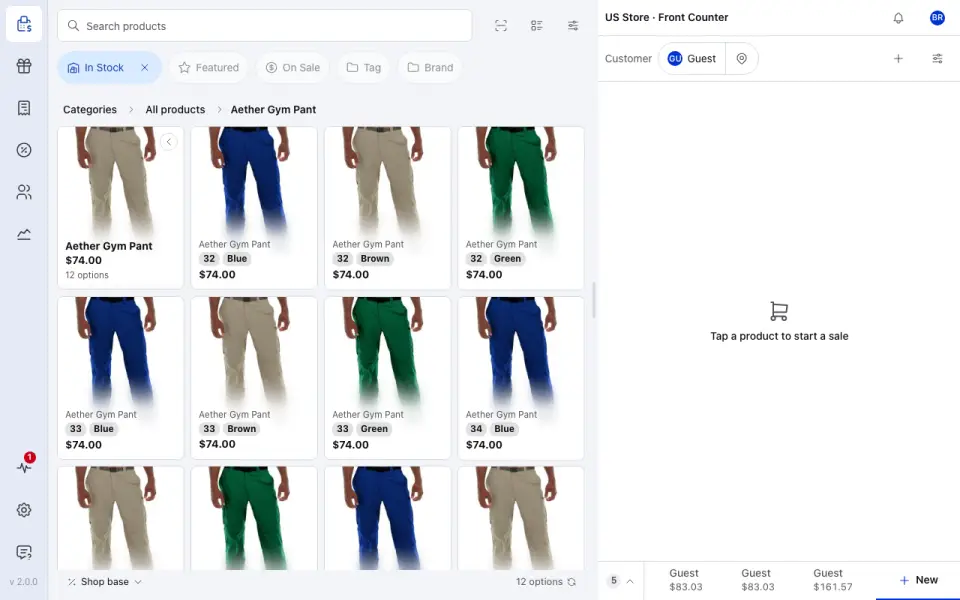 | 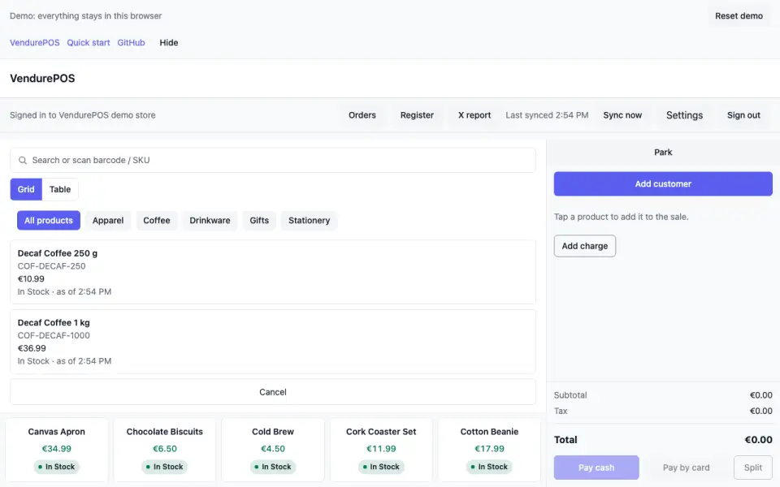 |

- [ ] **4.1 Variants open in place in the grid** as tiles with attribute chips ("32 Blue") and a Back tile. VendurePOS swaps the cart column for a variant list. *App:* the grid. *Vendure way:* option groups as the chips.

## 5. Customer on the order

| WCPOS | VendurePOS |
|---|---|
| 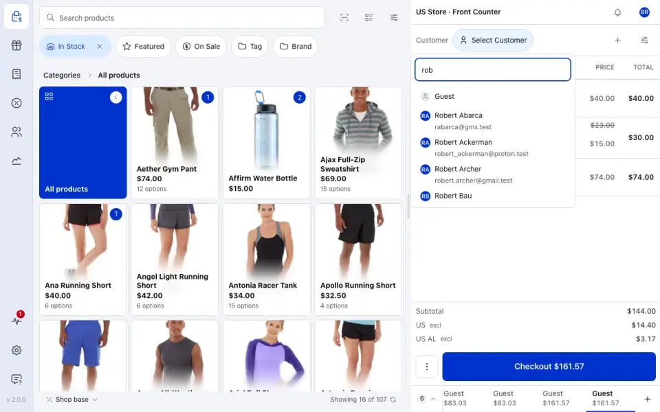 |  |

- [ ] **5.1 Customer picker** with avatars and a Guest row. VendurePOS's search, list and "New customer" are close. *App.*
- [ ] **5.2 Per-order address editor:** billing, "shipping same as billing", company, tax ID, opened from an address pin beside the cart's customer chip (2.3). *App + plugin.*

## 6. Register and cashier

| WCPOS | VendurePOS |
|---|---|
| 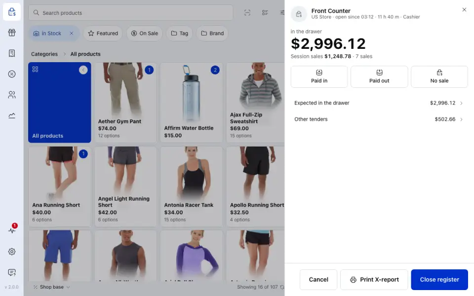 | 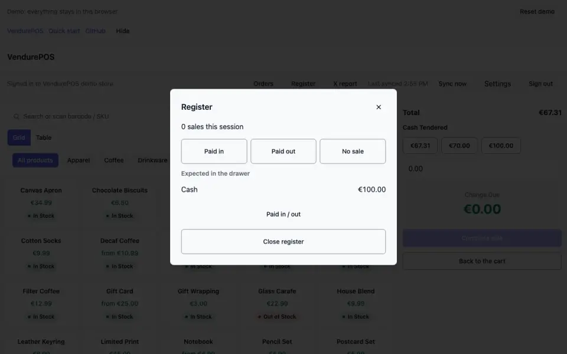 |
|  | — |

- [ ] **6.1 Avatar sheet.** Its parts:
  - cashier, store, register and "since";
  - "Your sales today" and "In the drawer";
  - Pay in, Pay out and Close register;
  - hand the till to another account;
  - Sign out.

  VendurePOS has top-bar buttons. *App;* store and register switching need *plugin* support.
- [x] **6.2 Register panel header:** the drawer total, "open since 03:12 · 11 h 34 m", other tenders, and Print X-report in the panel. Done (spec B12): the Register door opens TallyUI 3.20.0's `RegisterPanel` as v2's right-hand sheet (`presentation="side"`): "store · open since HH:MM · N m · Cashier", the cash in the drawer with session sales, the ledger and Other tenders, and a Print X-report / Close register footer; the X report left the cashier sheet (demo e2e "the register panel is v2's side sheet"). *Left:* the title reads "Register", since a single-register store has no register name (6.6).
- [ ] **6.3 Pay in / pay out reason chips** (Float, Change, Bank, Other). VendurePOS has a free-text reason. *App.*
- [x] **6.4 Close register: a cashier never sees a raw error.** The capture showed "RegisterTenderInProgressError: Finish or cancel…" when closing during a tender. Done (spec B5): TallyUI 3.19.0's register panel and count show a refusal's message alone (`errorText`). A demo e2e now pins it: Close register during a checkout says "Finish or cancel the sale in progress first.", opens no count, and leaves the checkout open.
- [x] **6.5 Count the drawer by denomination at close.**
- [ ] **6.6 Several registers per store, picked on the device** ("Which register is this device at?"). *Plugin + app.*

| WCPOS | VendurePOS |
|---|---|
|  |  |
| — |  |

## 7. Orders

| WCPOS | VendurePOS |
|---|---|
|  | 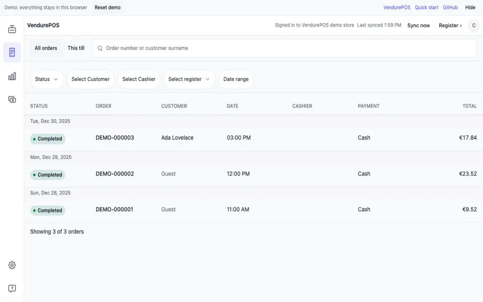 |
| 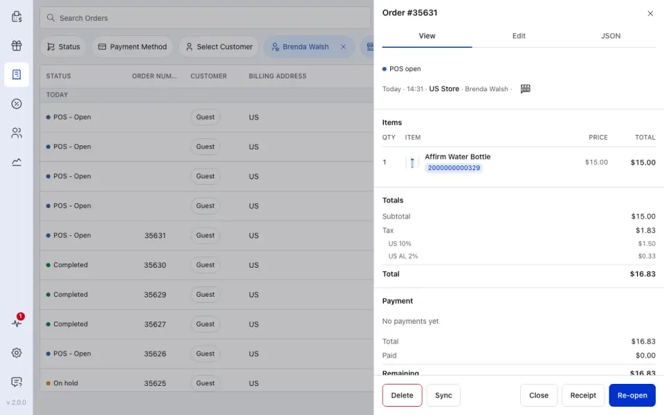 |  |

- [x] **7.1 Orders as a full screen from the rail.** It has a table (status, number, customer, date, cashier, payment method, total), is grouped by day, and has paging. Done (specs B14a, B14b): Orders opens on All orders, the store's orders from Vendure's own `orders` list in a table grouped by store day (status, order, customer, time, cashier, payment, total; a stacked row on a phone), 25 at a time with Show more and "Showing N of M orders". This till keeps the till's own orders with Needs attention and Retry. Demo e2e "the Orders panel lists the store's orders by day, and searches and filters them". *App.*
- [x] **7.2 Order search and filters:** status, payment method, customer, cashier, register, date range. Done (specs B14a, B14b): search by order code or customer surname, and TallyUI's `OrderFilterBar` pills for status, customer (searched on the store), cashier, register and date range in the store's timezone, each mapped to Vendure's `orders(options:)` filters and the plugin's `tallyCashierRef` and `tallyRegisterId` custom fields. No payment-method pill: every POS tender is stored as Vendure payment method `tally-pos` with the till's method in the payment's metadata, which Vendure's order list cannot filter on, so the pill would always mean "all". *App.*
- [x] **7.3 Order detail:** items, totals, payment, Receipt reprint. *Round 8:* the demo now answers `order(id)`, so on demo.vendurepos.com a tap on a seeded order or on a till sale opens the order sheet with its items, totals and payment (demo e2e "opens a seeded order"). *Round 9:* Receipt on the order sheet shows the stored order's receipt in the live receipt's layout, with the tendered cash and change the till recorded, and Print receipt prints it alone (demo e2e "reprints a finished sale's receipt"). *App.*
- [x] **7.4 Refund from the order detail.** Done in round 8: #216's refund sheet works on the demo too, because the demo store takes `order.refund` v1 under the plugin's rules (per-line shares, quantity left, split across payments, restock, expected cash). Demo e2e "refunds a mug from the order sheet".

## 8. Reports

| WCPOS | VendurePOS |
|---|---|
| 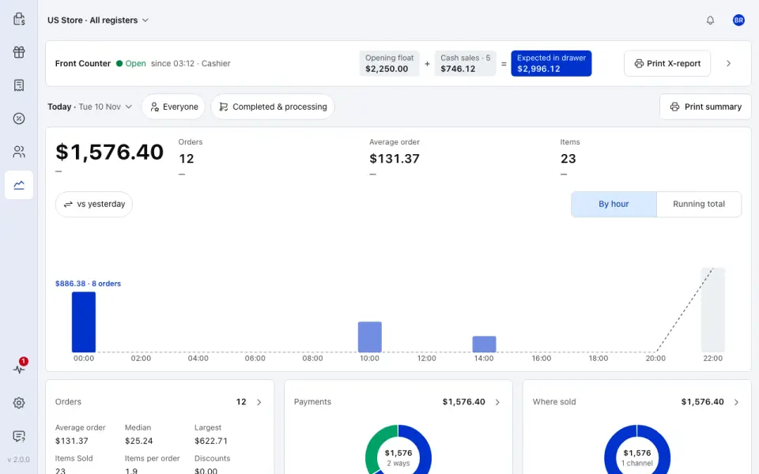 | 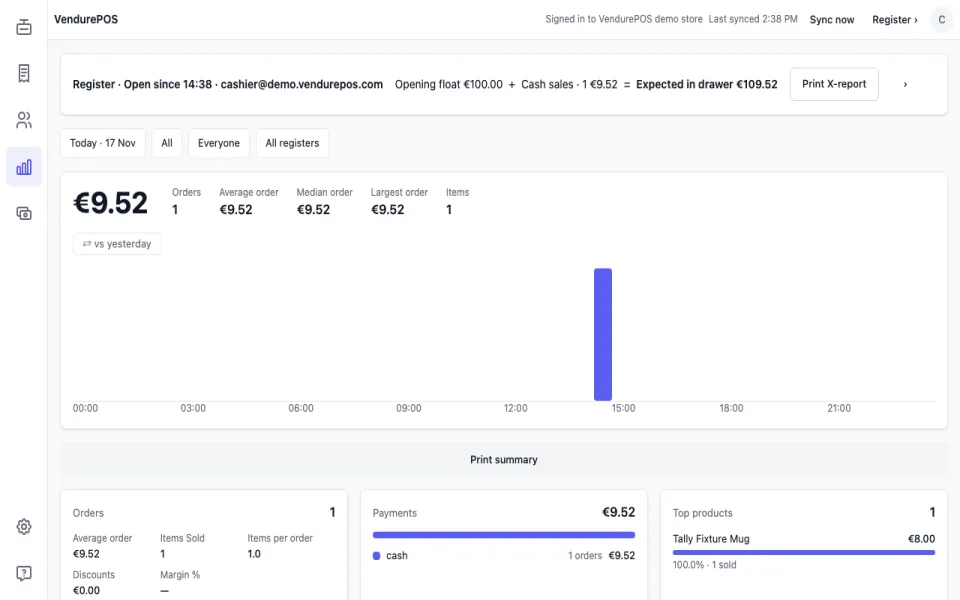 |
|  | — |

- [ ] **8.1 Reports screen.** It has:
  - a drawer card;
  - today's KPIs (sales, orders, average, largest, items, discounts, vs yesterday);
  - a by-hour chart, the payment-method split and top products.

  The plugin's sales report endpoint is on `main` (#213). *App:* the screen.

  Partly done (specs B13, B13b): Reports sits in the rail after Orders and opens a panel over the sale. It uses TallyUI 3.20.0's filters bar and cards around an app-local hero (`apps/pos/lib/till-sales-hero.tsx`). The panel works from this till's own sales: the local orders, without refused ones, and the applied refunds. It has:
  - the period, status, cashier and register filters;
  - the hero, as v2 has it:
    - the total, with Orders, Average order and Items beside it (under it on a phone);
    - one "⇄ vs yesterday" switcher;
    - by-hour bars for a one-day period, and day bars for longer ones;
  - the Orders card (with discounts), and the Payments, Products, Categories, Taxes and Refunds cards.

  A scan closes the panel and adds (demo e2e "Reports shows the till's sale for today").

  *Left:*
  - the drawer card;
  - the median and largest order;
  - Print summary;
  - store-wide figures from #213's endpoint;
  - the card panels.
- [ ] **8.2 Closures history** with cash at open and close, the discrepancy, and a CSV export. *App + plugin.*

## 9. Settings and look

| WCPOS | VendurePOS |
|---|---|
|  |  |
|  | 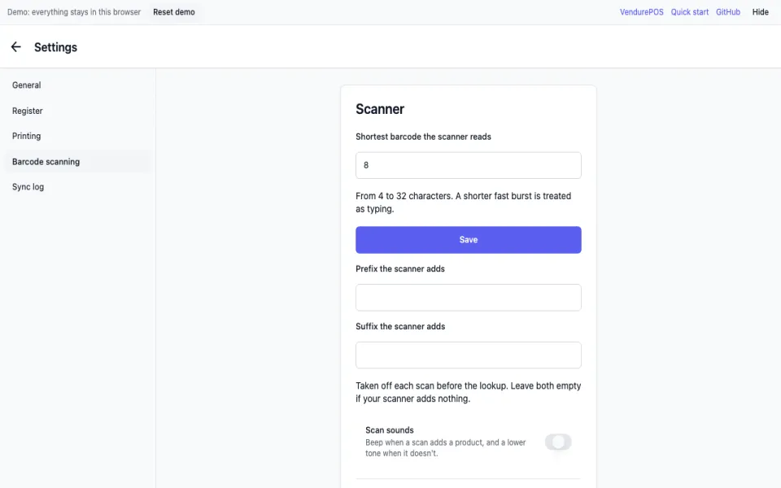 |
| 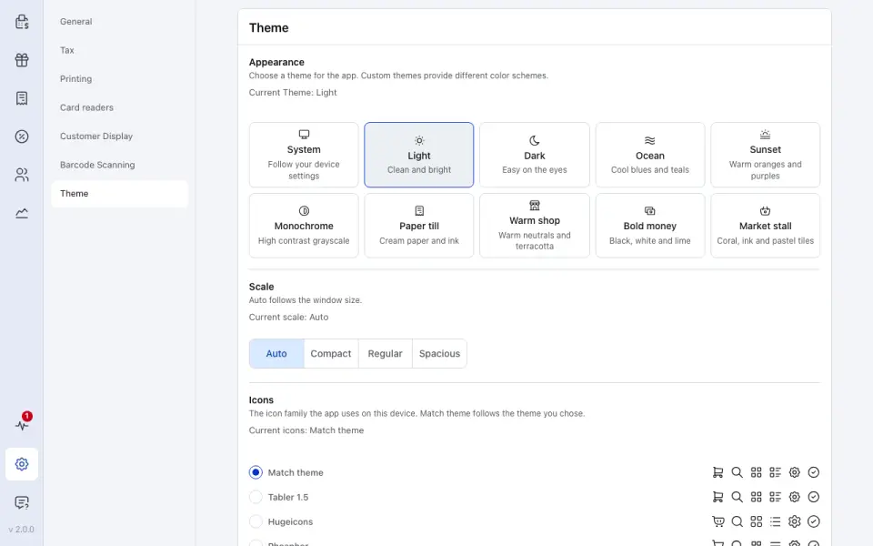 |  |

- [ ] **9.1 Tabbed settings area.** The tabs are General, Tax, Printing, Card readers, Customer display, Barcode and Theme. *Shared:* `SettingsLayout` exists in 3.12.0. *App:* adopt it. Done (specs B16a, B16b): Settings is TallyUI's `SettingsLayout`, a list of sections (General, Register, Printing on the web, Barcode scanning, Theme, Sync log) with only the chosen section beside it, General first; the chosen section is `aria-selected`. On/off settings (Price changes, Print after each sale, Scan sounds) are a label row with a switch, as v2 (spec B17). Below 768 px the list stacks behind Menu/Done. Demo e2e "Settings shows one section at a time, General first, and stacks behind Menu at phone width". *Left:* Settings is still a pushed screen with a back arrow, where v2 keeps the rail beside it (front desk, 2026-11-16: on the parity backlog, behind the remaining feature rows); Tax, Card readers, Customer display and Theme have their own rows (9.2, 9.6–9.8); on a phone, `SettingsLayout` keeps the list open after a pick until Done (TallyUI).
- [x] **9.2 Theme: System / Light / Dark, plus Scale.** *Shared* theme tokens, *app* settings. Theme done (specs B18a–B18a4): Settings › Theme picks System, Light or Dark (TallyUI's `UI_THEMES`). The choice is saved on this device (the app's key-value store, as v2 keeps it per device), applied through Uniwind, and applied again at start-up before any screen renders; System follows the device (#210). Demo e2e "Settings › Theme chooses Light or Dark over the device's scheme, and keeps it after a reload". Scale done (spec B18b): the same card picks Auto, Compact, Regular or Spacious (TallyUI's `UI_SCALES`), saved on this device and fed to TallyUI's `ScaleProvider` at the root (Uniwind's `ScopedVariables` on native). Auto, the default as in v2, is Compact under 640 px wide and Spacious from 1600 px; before this the till was always Regular. Demo e2e "Settings › Theme sets the scale, and keeps it after a reload". *Left:* v2's named themes beyond light and dark, icons and fonts need `@tallyui/theme` first; on native the status bar still follows the device, not the choice.
- [ ] **9.3 Language.** *Shared:* i18n.
- [x] **9.4 Barcode settings with a test area.** Done (spec B10): Settings › Scanner ends with v2's "Barcode scanning test": the last key the scanner sent with its gap in ms, and the code detected after the prefix, suffix and shortest length, with the scan sound as set (web). A scan on Settings no longer adds to the sale hidden under it (demo e2e "Settings' barcode test"). v2's average-time threshold is not a setting: the 24 ms key gap is fixed in code (`WEDGE_KEY_GAP_MS`), and the test area shows each key's gap against it. *App.*
- [ ] **9.5 Printing: printers and receipt templates.** VendurePOS has "Print after each sale". *Shared + app.*
- [ ] **9.6 Tax display options and "Tax based on: shop base / customer".** *App,* Vendure way: the zone.
- [ ] **9.7 Card readers.** *Shared + plugin,* Vendure way.
- [ ] **9.8 Customer display pairing.** *Shared + plugin.*
- [ ] **9.9 Product-grid settings sheet:** tile fields, browse by, sort, show out-of-stock. VendurePOS has products per row. *App.*
- [ ] **9.10 Cart settings:** panel side, open-orders position, columns, quick-discount presets, auto-show and auto-print receipt. *App.*

## 10. Back office

| WCPOS | VendurePOS |
|---|---|
|  |  |
|  | — |
| 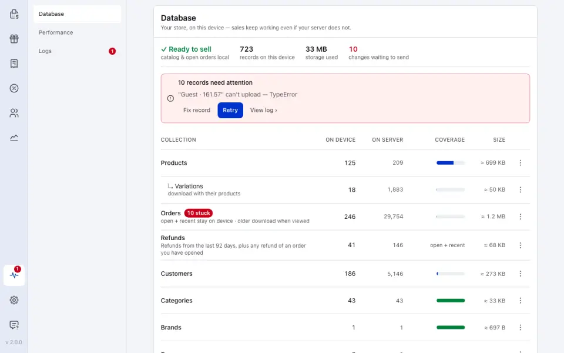 | — |

- [ ] **10.1 Customers screen:** list, search, edit. List and search done (specs B15a, B15b, B15b2): a Customers door between Orders and Reports opens the store's customers from Vendure's `customers` list, by surname, in v2's table (avatar, first and last name, email, default billing address, date created; a stacked row on a phone), 25 at a time with Show more and "Showing N of M customers", searched by name, email or phone. The walk-in customer is left out. A scan closes the panel and adds. Demo e2e "the Customers panel lists the store's customers by surname, searches them, and a scan closes it and adds". The door shows only to a role that can read customers (spec B15d, #246), and the billing address is two lines, as v2 (spec B15e, #247). v2's Customers screen opens no customer detail, so none is planned. Still to do: adding and editing a customer, parked on a shared TallyUI editor for billing, shipping and tax IDs (requested from the TallyUI lane). *App + shared.*
- [ ] **10.2 Products screen:** stock and price edited inline, with a manage-stock switch. *Plugin + app.*
- [ ] **10.3 Store health:** "Ready to sell", changes waiting to send, records that need attention (Fix / Retry), per-collection coverage. VendurePOS has Settings › Sync log and "Last synced / Sync now". *App.*
- N/A **10.4 Coupons screen.** Vendure promotions are managed in the Vendure admin (`AUDIT.md` §19). A coupon-code field in the cart is a separate row once one is found in WCPOS's cart.

## 11. Rarely seen

| WCPOS | VendurePOS |
|---|---|
| 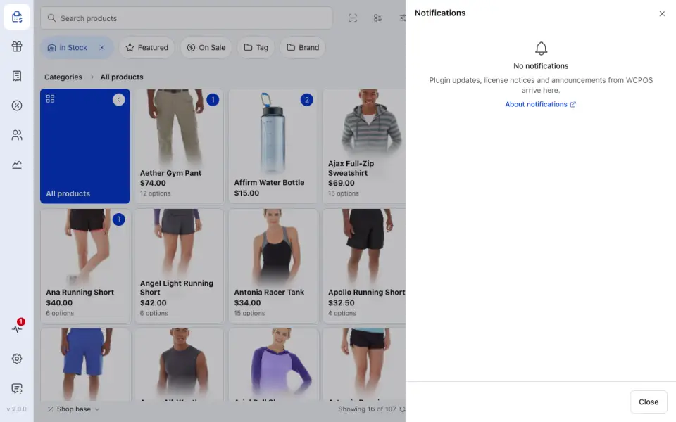 | — |

- [ ] **11.1 Notifications bell and inbox.** *App.*
- [x] **11.2 Support entry in the rail.** *App:* for VendurePOS, docs and GitHub links in place of a chat widget. Done (spec B11): Support sits at the foot of the rail under Settings (in the drawer on phones) and opens a side sheet with the quick-start guide, "Report a problem on GitHub" and the app version; a scan closes it and adds, as for the Orders panel (demo e2e "Support at the foot of the rail").
- N/A **11.3 Sign-in page.** WCPOS uses the store's WordPress login; VendurePOS has its own sign-in and a demo landing page. Neither is a POS screen to match.

---

## Rounds

| Round | Date | Score | Moved |
|---|---|---|---|
| 1 | 2026-11-10 | 3 / 56 | Baseline. |
| 2 | 2026-11-12 | 4 / 56 | B1 frame: 1.2. |
| 3 | 2026-11-12 | 6 / 56 | B2 cart: 1.4, 2.4. |
| 4 | 2026-11-12 | 9 / 56 | B3 checkout: 2.2, 3.3, 3.4; 3.1 and 3.2 mostly done. |
| 5 | 2026-11-12 | 11 / 56 | B4 cart lines: 2.7, 2.8. |
| 6 | 2026-11-12 | 12 / 56 | B5 close during a tender: 6.4 (a regression test; the fix came with TallyUI 3.19.0). |
| 7 | 2026-11-12 | 14 / 56 | B6 camera scan: 1.7; 1.3 checked on the demo and already at parity (TallyUI 3.20.0). |
| 8 | 2026-11-12 | 15 / 56 | B7 demo orders: 7.4; 7.3 opens on the demo, receipt reprint still missing. |
| 9 | 2026-11-12 | 16 / 56 | B8 receipt reprint: 7.3. |
| 10 | 2026-11-12 | 18 / 56 | B9 cart header: 2.3 customer chip, 2.12 add toast; the address pin moves to 5.2. |
| 11 | 2026-11-12 | 19 / 56 | B10 Settings: 9.4 barcode scanning test; the till's scanner listens only while the till is in front. |
| 12 | 2026-11-12 | 20 / 56 | B11 rail: 11.2 Support with the quick start, GitHub issues and the version. |
| 13 | 2026-11-12 | 21 / 56 | B12 register: 6.2 the panel is v2's side sheet with the session header and Print X-report. |
