# VendurePOS against demo.wcpos.com/pos: look-and-function checklist

**Finish line** (Paul, 10 Nov 2026, via the front desk): VendurePOS looks and functions like https://demo.wcpos.com/pos.

This file is the screen-by-screen, flow-by-flow list behind that goal. `AUDIT.md`, next to it, is the code-level audit against WCPOS 2.0.0's source. This list compares the two **running demos** as a cashier sees them.

## How to read this

**Sources**
- Captured 2026-11-10 at 1280×800:
  - WCPOS demo 2.0.0, signed in as demo/demo, store "US Store", register "Front Counter";
  - demo.vendurepos.com, built from `main` at 13:27 UTC.
- The WCPOS demo was only looked at. Nothing was saved, paid or synced, and every order push was blocked before it left the browser.
- The screenshots are in `demo-pairs/`, named `<nn>-<screen>-<wcpos|vendurepos>.webp`. A missing VendurePOS shot means the screen does not exist there.

**Order:** sections and rows follow what a cashier notices first. Section 1 is on screen for every sale; the last section is rarely opened.

**Row tags**
- **Owner** says where the work lives:
  - **app** is `apps/pos`;
  - **plugin** is `packages/vendure-plugin`;
  - **shared** is a TallyUI package, owned by the TallyUI worker and requested through the front desk.
- **Vendure way:** where WCPOS's mechanism is WooCommerce's own, the row asks for the Vendure equivalent (Paul, 2026-10-07). For example, facets stand in for tags and brands, and promotions for coupons.
- `[x]` means a cashier would call it the same. Partly-there rows stay `[ ]`, with the gap named.

**Score:** **32 / 56** rows at parity (round 20, 2026-11-19: no new ticks; round 19 added 9.8). The two rows marked N/A are not counted.

---

## 1. Sell screen frame (every sale)

| WCPOS | VendurePOS |
|---|---|
|  | 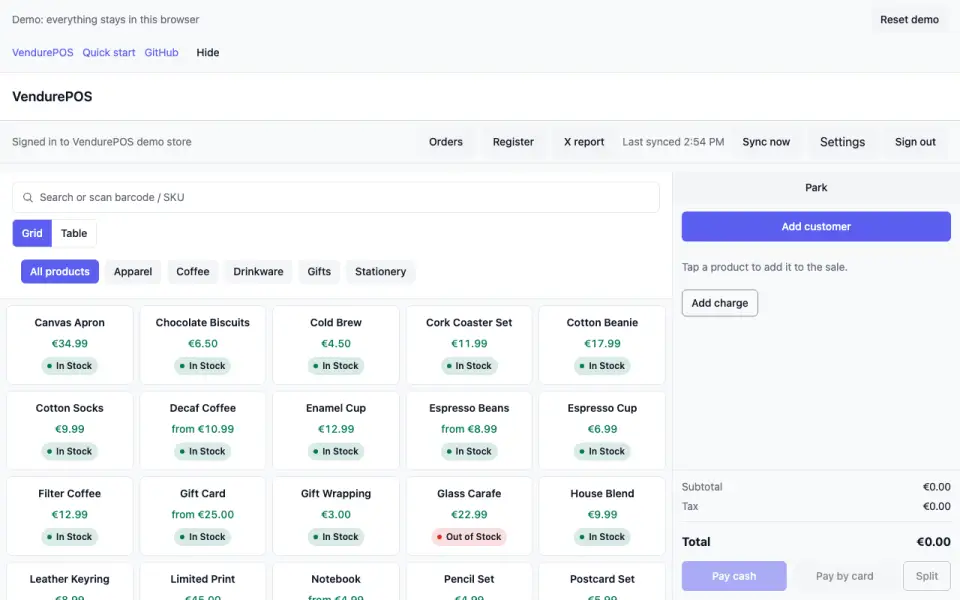 |

- [ ] **1.1 Navigation rail.** Wide screens show a left icon rail (POS, Products, Orders, Customers, Reports; Store health, Settings and Support at the foot; the version number), and phones get a drawer. Done (spec B1, TallyUI 3.18.0 `AppShell`): the rail on wide screens and the drawer on phones, with POS, Orders (badged with orders that need attention), Register and Settings. Support is at the foot too (11.2, spec B11), and Reports follows Orders (8.1, spec B13). Customers followed (10.1, spec B15). Done (#281, #273, #282): Products follows POS (10.2), and Notifications and Store health sit at the foot above Settings (11.1, 10.3). *Left:* the rail shows no version number (the Support sheet does), and TallyUI 3.20.0's `NavRail` has no foot slot for one (*shared*).
- [x] **1.2 Compact header.** One slim bar reading "Store · Register", with a bell and the cashier's avatar. Done (spec B1): one `RegisterBar` row (the name, the register pill, the signed-in store, last synced and Sync now on wide screens, the Register door, the avatar); the avatar opens a cashier sheet with Closures and Sign out (the X report moved to the register panel, 6.2); the demo build has no banner (#256). A single-register store shows no register name, as in v2. Done (1.2b): when the store lists more than one register, the bar reads "VendurePOS · <register>", the bound register by its last device name or "Register <first 8 of its id>" (demo e2e "the header bar names the till's register once the store lists more than one", shot 02g-sell-header-register beside 02-sell-empty-wcpos). No bell in the bar: Notifications is a door at the rail's foot (11.1).
- [x] **1.3 Product images on tiles.** *App/shared:* the Vendure connector needs `featuredAsset`, and the tile needs an image slot. Done (checked in round 7, no code change): TallyUI's `Catalogue` grid tile renders the product image, the Vendure connector reads `featuredAsset` and then `assets[0]`, and the till's CSP allows `https:` images. On demo.vendurepos.com on 2026-11-12, 30 of 30 tiles showed a loaded picture, at both wide and phone width.
- [x] **1.4 In-cart quantity badge on a tile.** *Shared:* the tile. Done (spec B2): the till passes its cart lines to TallyUI 3.18.0's `Catalogue`, whose grid tiles show the count.
- [ ] **1.5 Browse by category.** Coloured category poster tiles with counts, a breadcrumb ("Categories › All products"), then the products. VendurePOS shows every product, with category chips. *Left:* all of it. TallyUI 3.20.0's `Catalogue` has no browse-by-category mode: its `CategoryTile` is unused, and `categories` takes only an id and a name. *Shared* first, then *app;* Vendure way: collections. TallyUI merged the browse mode (`categoryBrowse="tiles"`, tallyui#823, 16 Nov); it waits on the next `@tallyui` release.
- [ ] **1.6 Filter pills.** In stock, On sale, Featured, Tag and Brand, with a searchable picker per pill. *Vendure way:* in stock, on sale, plus one pill per facet. *Shared:* `FilterChipGroup` exists in 3.12.0, so the work is the *app* wiring and the facet reads. *Round 7 finding:* TallyUI 3.20.0's `Catalogue` takes `showFilterBar` and `filterChips`, but it applies only the In stock chip itself. It never passes `ProductFilterBar` an `onTermPress`, so the term pills cannot open a picker. Facet pills therefore need a TallyUI change first (shared), and On sale needs a ruling on what "on sale" means for Vendure, which has no compare-at price. *Left:* the till shows no filter bar yet. The In stock pill alone is *app* wiring (`showFilterBar`, `filterChips: ['inStock']`); facet pills are *shared;* On sale and Featured wait on a ruling. *Round 15:* the till shows the In stock pill, on by default (#258), and Settings › General can show or hide out-of-stock products (#268, 9.9). *Left:* facet pills (*shared*), On sale and Featured (a ruling).
- [x] **1.7 Camera scan button next to search.** Search itself is at parity. *App.* Done (spec B6): on web the Products search has TallyUI 3.20.0's camera button and inline `CameraScannerPanel`, with a resizable height that is remembered. Every accepted read goes through the same scan handler as a wedge scan (`docs/scan-policy.md`). An item resting in view is added once. The camera is let go while the catalogue is hidden. Native (1.7b): built, device proof owed (#319). The same panel takes expo-camera's `CameraView` as its viewfinder, loaded lazily from `lib/native-camera.native.tsx`, and the button is hidden where the camera module is absent.
- [ ] **1.8 "Showing n of N" and infinite load at the foot of the grid.** VendurePOS's grid holds the whole local catalogue, virtualised, so infinite load has nothing to do. *Left:* the "Showing n of N" line. TallyUI 3.20.0's `Catalogue` and `ProductGrid` have no foot slot for it. *Shared.*
- [ ] **1.9 Grid and table toggle.** Both demos have one. *Left:* comparing the columns. WCPOS's table capture (02e) shows category rows, so its product columns are not captured yet. VendurePOS's are TallyUI's fixed Name, SKU, Barcode, Price, Stock and Category, and `Catalogue` takes no columns prop, so a column change is *shared*.

| WCPOS | VendurePOS |
|---|---|
| 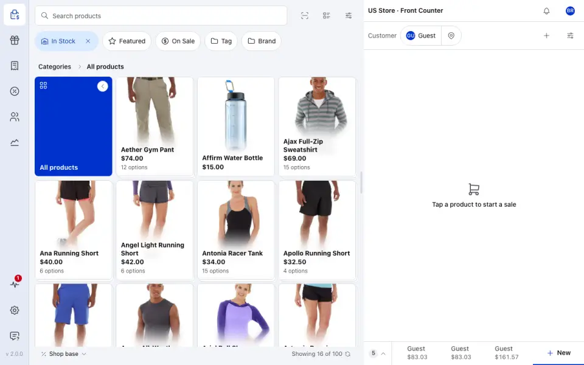 |  |

## 2. Cart (every sale)

| WCPOS | VendurePOS |
|---|---|
| 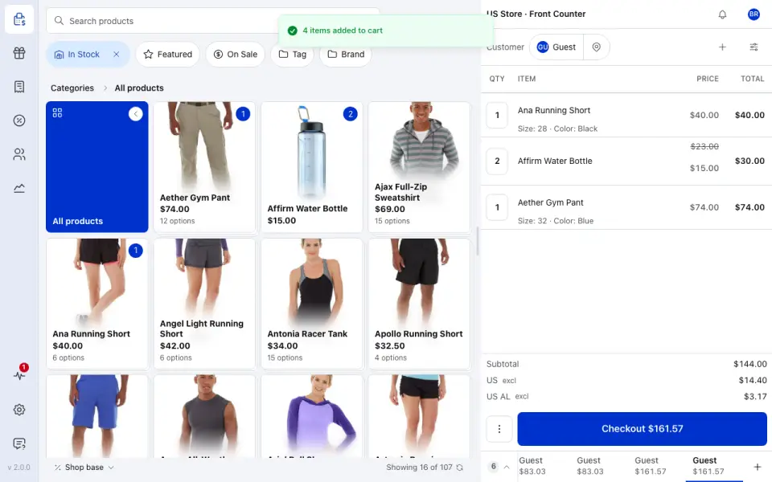 |  |

- [x] **2.1 Open carts as tabs.** Every cart stays open by itself, and a strip under the cart shows "Guest $83.03 …", a count and "+ New"; one tap switches. Done (#259): every open sale is a tab at the foot of the cart (TallyUI 3.20.0's `OpenSaleTabs`), with a New cell; a tap parks the current sale and opens the chosen one, and a refused switch (partly paid, payment in motion) says why. The Park dialog stays, as the place a parked sale is discarded. Demo e2e "opens two sales as tabs". *App.*
- [x] **2.2 One "Checkout €total" button** opening the checkout screen (section 3). Done (spec B3): the cart foot has one "Checkout €total" button in place of Pay cash, Pay by card and Split.
- [x] **2.3 Customer chip in the cart header** ("GU Guest", with an address pin). Done (spec B9): the cart header reads "Customer" and a chip with an initials avatar and the customer's name, or Guest; the chip opens the customer picker and a small × removes the customer (demo e2e "sees Guest in the cart's customer chip"). The address pin opens v2's per-order address editor, so it moves to 5.2. *App.*
- [x] **2.4 Line table with column heads** QTY / ITEM / PRICE / TOTAL. *Shared:* `CartPanel`. Done (spec B2): TallyUI 3.18.0's `CartColumnHeads` and `CartLine` in the till's own cart; the Price column folds on a narrow cart or a phone, as in v2. The price popover followed in spec B4 (2.7).
- [ ] **2.5 Line shows the variant's attributes** ("Size: 32 · Color: Blue") **and a struck-through regular price** on sale items. VendurePOS shows "name · variant" and no regular price. *Left:* both. TallyUI's Vendure connector reads a variant's options without their group names and has no regular price, so `CartLine` has no attributes or strike-through to show. *Shared* (connector); the struck-through price needs a ruling, since Vendure has no compare-at price.
- [ ] **2.6 Tap the quantity for a keypad popover** (− / +, 0–9, Done). *Shared:* a keypad popover. Mostly done (spec B2): tapping a line's quantity opens TallyUI 3.18.0's `LinePopover` keypad (0–9, delete, Apply, Cancel), with the line's Discount and Remove as its actions (spec B4). *Left:* the keypad has no − / + keys, and `LinePopover` has no prop for them.
- [x] **2.7 Tap the price for a keypad with quick discounts** (−5 / −10 / −15 %). Done (spec B4): when the till allows price edits, tapping a line's price opens TallyUI's `LinePopover` price keypad. It has v2's −5 / −10 / −15 % quick keys and strikes through the regular price when the line is sold below it. When the Price column folds (narrow cart or phone), Price is an action in the quantity keypad and opens the price form.
- [x] **2.8 Quiet lines.** WCPOS shows Edit / Remove on hover. Done (spec B4): the line shows only quantity, name, price and total. Discount and Remove are actions in the line's quantity keypad, one tap away, the touch-first equivalent of v2's hover (a till tablet has no hover).
- [x] **2.9 Itemised tax lines in the totals.** VendurePOS shows "incl. Reduced DE 7 %" and "incl. Standard DE 19 %", Vendure's way.
- [ ] **2.10 "+" menu:** misc product, fee, shipping, discount, new customer. VendurePOS's "Add charge" covers fee, shipping and custom item. *Left:* a percentage fee and an "amount includes tax" switch. TallyUI 3.20.0's `ChargeForm` and `ChargeInput` take a fixed amount only. *Shared* first, then *app.*
- [ ] **2.11 Order details dialog:** customer note, tax exempt, void. VendurePOS has only an order discount. Partly done (#265): a ⋮ beside Checkout opens Order details with Void. Done (#284, P2.11a): the customer note, sent in order.create v7, which the plugin now takes (versions 6 and 7), with a demo shot of Order details holding the note. Done (2.11b, this PR): Print in Order details prints the open sale as a bill titled "Bill — not paid", with no payment, change or order number and no change to the sale (shots 04i-cart-print-bill). *Left:* tax exempt: TallyUI has no support for it (*shared + plugin*).
- [x] **2.12 Toast when an item is added.** Done (spec B9): every add the sale takes, by tap or scan, shows "<item> added to cart" at the top of the till for 2.5 s; a refused add shows none, and the toast never takes a tap (demo e2e "a toast when an item is added"). *App.*

| WCPOS | VendurePOS |
|---|---|
| 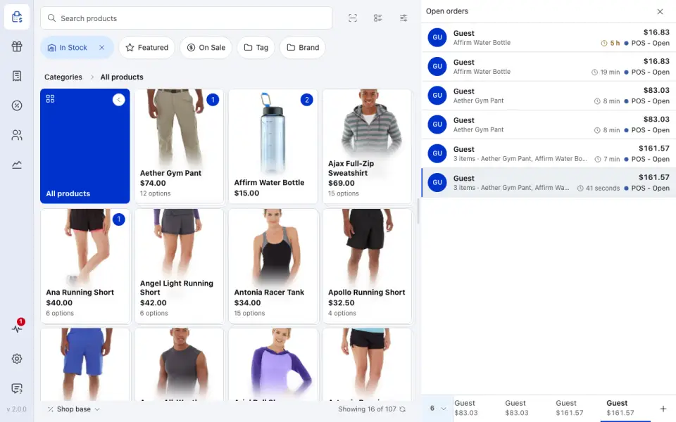 |  |
|  |  |
| 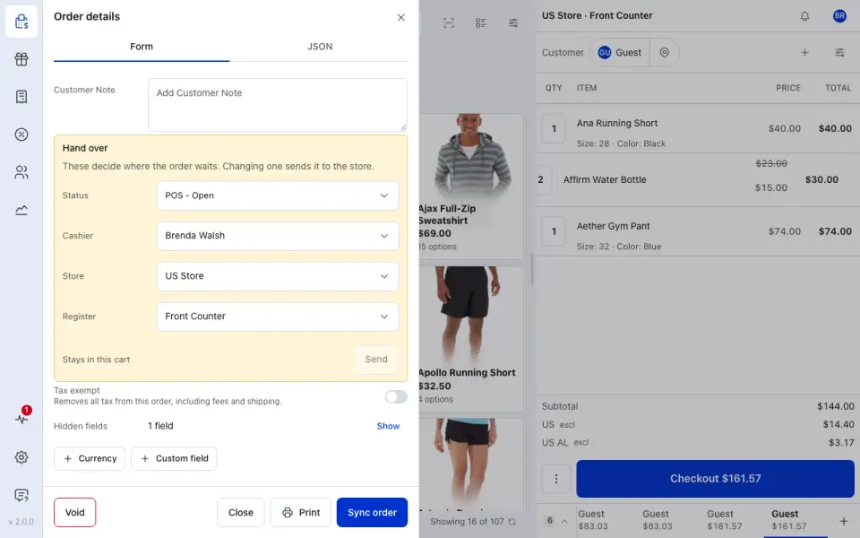 | 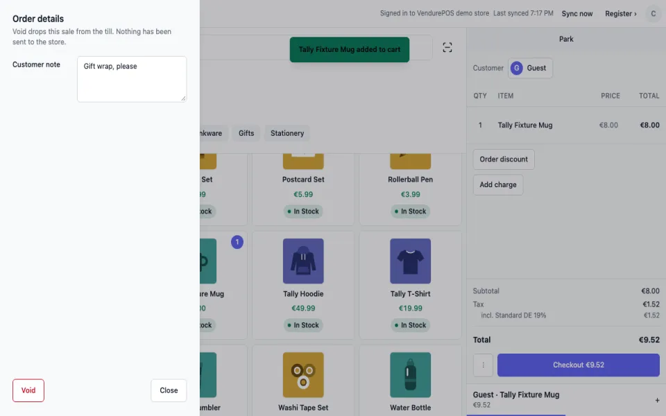 |

## 3. Checkout and tender (every sale)

| WCPOS | VendurePOS |
|---|---|
|  | 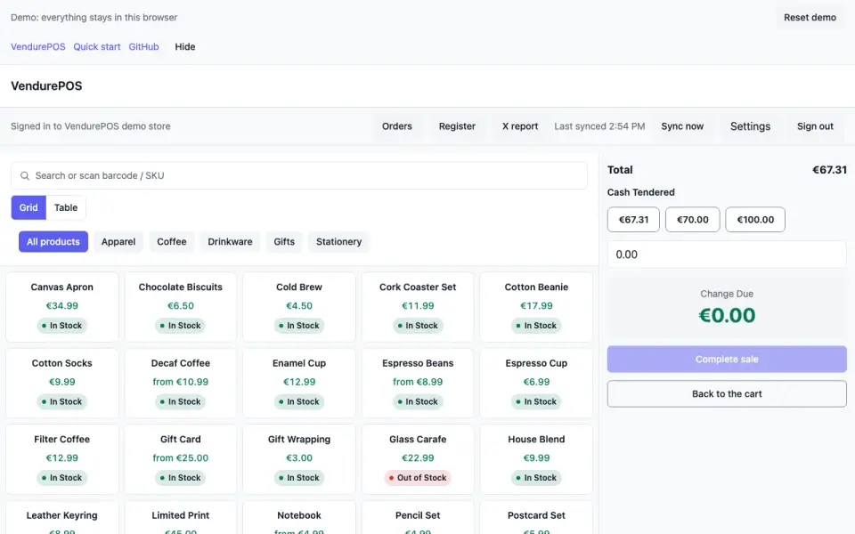 |

- [x] **3.1 Full-screen checkout.** Its parts:
  - "TO PAY €x" with a Split chip;
  - payment-method cards;
  - quick amounts and a numeric keypad;
  - the order summary on the right, with a Payments list and Total / Paid / Remaining.

  Mostly done (spec B3): Checkout opens TallyUI 3.19.0's `TenderPane` in the catalogue's place, with "Remaining €x", method tiles, quick amounts, a keypad and the Payments list; the cart stays on the right, locked, with its totals. On a phone the pane fills the Cart tab. *Left:*
  - the Split chip. TallyUI 3.20.0's tender state takes a split plan (even, fixed amounts, items), but `TenderPane` draws no chip or sheet for it. The app can draw them beside the pane and dispatch the plan (*app*); a chip inside the "TO PAY" headline needs a slot (*shared*).

  Paid and Remaining now sit under Total in the locked cart, as v2 (#266). Done: the Split chip beside the pane splits evenly 2–6 ways (#275), by a fixed amount (#292) and by items (#293, with an order discount #295); demo-pairs/05b, 05c. Round 18: at parity. The chip sits above the total, not inside the "TO PAY" headline, which needs a slot in `TenderPane` (*shared*, cosmetic); the method tiles are 3.2.
- [ ] **3.2 Payment-method list on one screen:** Cash, Card, and the store's other methods. Mostly done (spec B3): Cash and Card terminal are tiles on the one checkout screen. *Left, Vendure way:* the tiles are the till's fixed pair, not the channel's own payment methods. TallyUI 3.20.0's `TenderPane` offers only the `cash` and `external` methods, and the plugin stores every tender as `tally-pos`. *Shared + plugin.*
- [x] **3.3 Split payments shown as a Payments list** with Paid and Remaining. Done (spec B3): each leg is a ledger row (method, amount, Captured, Cancel payment) under "Remaining €x" and "€x of €y paid"; the next leg pre-fills the remaining balance.
- [x] **3.4 Quick cash amounts complete the sale.** Done (spec B3): tapping €50.00 and Take enables Complete sale and shows the change; e2e "a demo cashier pays cash with a quick amount" proves it.
- [x] **3.5 Receipt after the sale** with Print and New sale.

| WCPOS | VendurePOS |
|---|---|
| — | 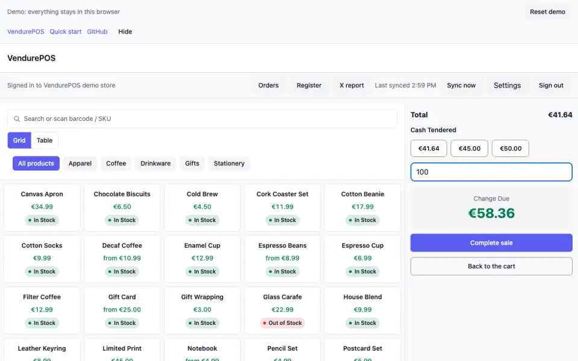 |
| — | 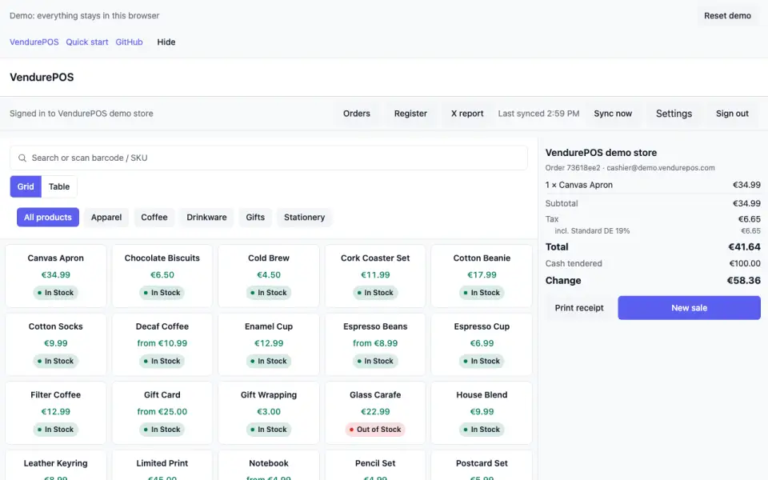 |

## 4. Variants

| WCPOS | VendurePOS |
|---|---|
|  |  |

- [ ] **4.1 Variants open in place in the grid** as tiles with attribute chips ("32 Blue") and a Back tile. VendurePOS lists the variants above the grid, in the products column, each with SKU, price and stock. *Left:* variant tiles in the grid with option chips and a Back tile. TallyUI 3.20.0's `Catalogue` has no such mode, and its popover mode needs `getVariantOptions`, which the Vendure connector lacks. *Shared;* Vendure way: option groups as the chips.

## 5. Customer on the order

| WCPOS | VendurePOS |
|---|---|
|  | 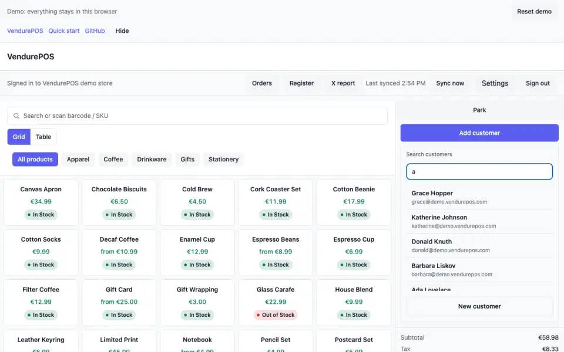 |

- [ ] **5.1 Customer picker** with avatars and a Guest row. VendurePOS's search, list and "New customer" are close. *Left:* avatars and a Guest row. TallyUI 3.20.0's `CustomerPicker` does not pass on `CustomerSelect`'s `showAvatar` and has no Guest row. *Shared.*
- [ ] **5.2 Per-order address editor:** billing, "shipping same as billing", company, tax ID, opened from an address pin beside the cart's customer chip (2.3). *Left:* all of it. TallyUI 3.20.0 has no address editor (10.1 waits on the same one), and an order's billing and shipping go out only in order.create v8, where the plugin stops at v5. *Shared + plugin.*

## 6. Register and cashier

| WCPOS | VendurePOS |
|---|---|
|  |  |
|  | 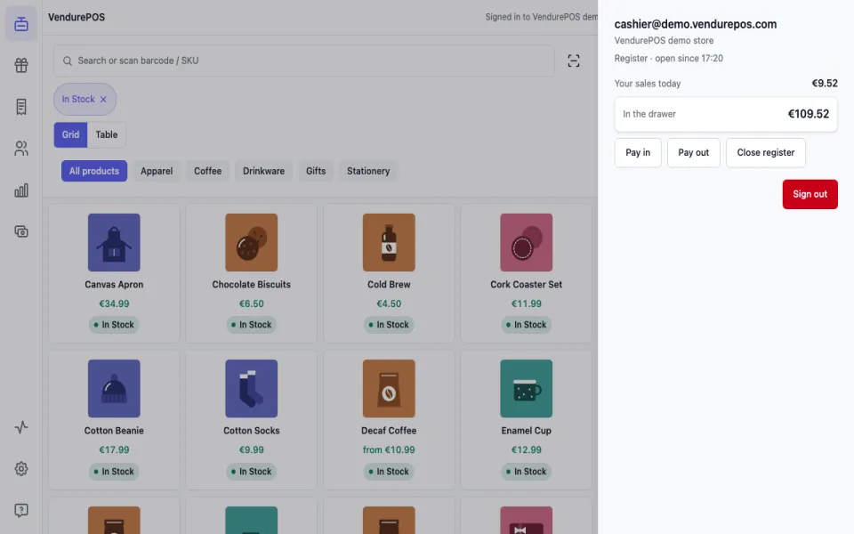 |
|  | 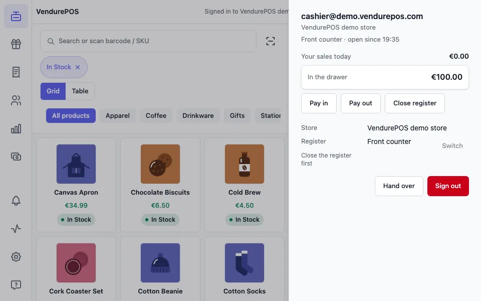 |

- [x] **6.1 Avatar sheet.** Its parts:
  - cashier, store, register and "since";
  - "Your sales today" and "In the drawer";
  - Pay in, Pay out and Close register;
  - hand the till to another account;
  - Sign out.

  VendurePOS's avatar opens a cashier sheet with the name, the store, Closures and Sign out (1.2). Since #262 it also shows the shift while the register is open: the register and since when, session sales and the drawer (hidden during a blind count), and Pay in, Pay out and Close register. Done (#271): the header names the register and since when, with the day for a register left open overnight; "Your sales today" is the signed-in cashier's gross for today from this till's orders and refunds; "In the drawer" is a card with the expected cash, and session sales are gone, as in v2 (demo e2e "the cashier sheet shows the register and since in its header, your sales today and the drawer, Pay in and Close register"). Done (#277): Hand over in the cashier sheet asks with TallyUI's `SwitchConfirm` (its warnings from `switchWarnings`), can print the hand-over slip, signs this account out and leaves the register open for the next (demo e2e "Hand over in the cashier sheet signs this account out and leaves the register open for the next"). Since 6.1e the header, the hand-over confirm and the slip name the register the till is at, as the register panel does (6.2), and read "Register" without a name (demo e2e "the cashier sheet and the hand-over name the register the till is at").

  Done (6.1f, this PR): v2's Store and Register rows. Store shows the store read-only: a Vendure channel means signing in again (AUDIT §20). Register names the register as Settings' picker does ("This device" for the till's own) and its Switch opens that same picker. The till then opens the register it was switched to. While the till holds its register (open, or counting until its closure is written), Switch is off with "Close the register first", the picker's own rule, where v2 says "Finish or park the current sale" (demo e2e "the cashier sheet switches the register the till is at, and holds it while the register is open"). Switching cashier is M7.
- [x] **6.2 Register panel header:** the drawer total, "open since 03:12 · 11 h 34 m", other tenders, and Print X-report in the panel. Done (spec B12): the Register door opens TallyUI 3.20.0's `RegisterPanel` as v2's right-hand sheet (`presentation="side"`): "store · open since HH:MM · N m · Cashier", the cash in the drawer with session sales, the ledger and Other tenders, and a Print X-report / Close register footer; the X report left the cashier sheet (demo e2e "the register panel is v2's side sheet"). Since 6.6c the title names the register the till is at, by its last device name (GET /tally/v1/registers), and reads "Register" when that register has no name or the list cannot be fetched, never an id (demo e2e "the register panel names the register the till is at"). Done (4.3a, AUDIT §4, desk ruling 2026-11-20): v2's overdue-close prompt. Settings › Register takes a "Close by" time (24-hour), kept on this device under a key carrying the register id, so a second device at the same register keeps its own; once an open session runs past it, the bar shows Overdue and, with the cart empty, the cart column offers Close register, which starts the count (demo e2e "a Close by time in the past makes the open register overdue…"; shot `demo-pairs/09f-register-overdue-vendurepos.webp`; v2 has no capture of it, nearest 09b). *Left:* v2 sets the time per register on the store; moving it there is a copy of the keyed value. Done (6.2b, AUDIT §4 "chips for the default float", desk ruling 2026-11-20): Settings › Register takes an "Opening float", kept on this device under a key carrying the register id (a second device at the same register keeps its own); Open register starts from it, records it as the expected float, and offers "Use the configured float" beside TallyUI's last-count chip (demo e2e "an opening float set in Settings prefills Open register and offers it as a chip"; shot `demo-pairs/09g-register-open-float-vendurepos.webp`; v2 has no capture of the open card, nearest 09b). *Left:* v2 keeps the float per register on the store; moving it there is a copy.
- [ ] **6.3 Pay in / pay out reason chips** (Float, Change, Bank, Other). VendurePOS has a free-text reason. *Left:* the chips. TallyUI 3.20.0's `MovementSheet` has the free-text reason only, with no prop for chips. *Shared.*
- [x] **6.4 Close register: a cashier never sees a raw error.** The capture showed "RegisterTenderInProgressError: Finish or cancel…" when closing during a tender. Done (spec B5): TallyUI 3.19.0's register panel and count show a refusal's message alone (`errorText`). A demo e2e now pins it: Close register during a checkout says "Finish or cancel the sale in progress first.", opens no count, and leaves the checkout open.
- [x] **6.5 Count the drawer by denomination at close.** Since 4.4a (this PR), the count opens with a "Before you close" card when the close leaves something on this till: "1 parked sale" (or n parked sales) and "A sale is partly paid", in TallyUI's `switchWarnings` words, as v2 warns about open carts (AUDIT §4). It shows whichever door started the close (cashier sheet, register panel, overdue offer). Unsent sales are not listed there: the close already waits for them (`closure-hold.ts`). Other open sale tabs are not counted: `switchWarnings` has no code for them (demo e2e "the count warns about a parked sale before the register closes").
- [x] **6.6 Several registers per store, picked on the device** ("Which register is this device at?"). Done: the plugin lists the channel's registers with `GET /tally/v1/registers` (#283, P6.6a); Settings › General picks the register this device is at with TallyUI's `RegisterPicker`, and the till follows it (#291, P6.6b; demo e2e "Settings › General picks the register this device is at, and the till follows it"); a register open on another till gets the conflict card, never a second drawer (#294; smoke e2e); the register panel, the cashier sheet and the hand-over name the register (#296 P6.6c, #297). *Plugin + app.*

| WCPOS | VendurePOS |
|---|---|
| 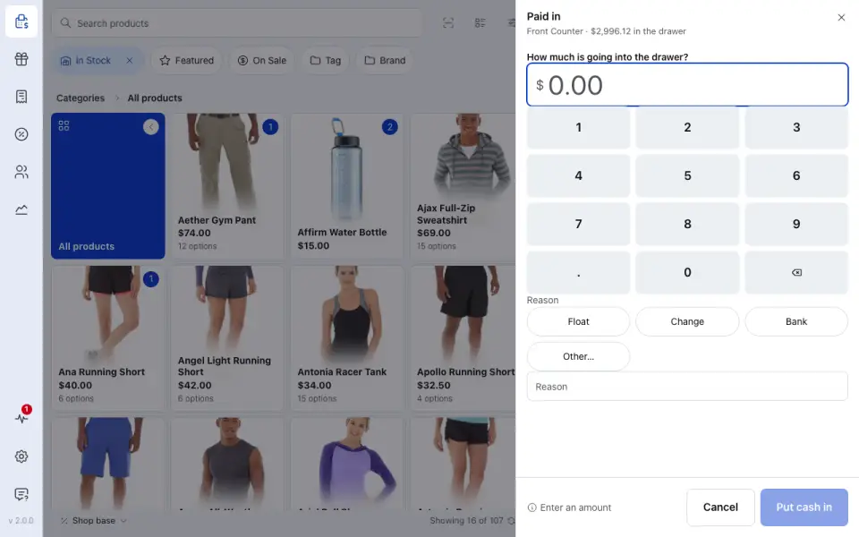 | 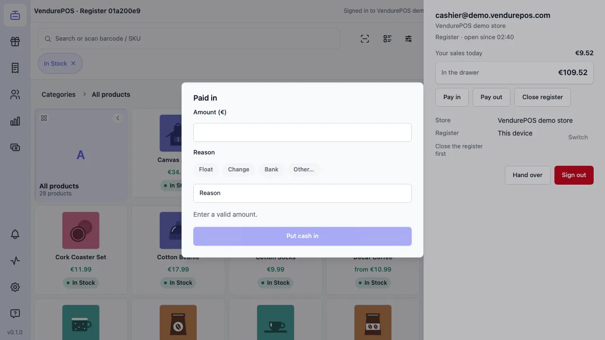 |
| — | 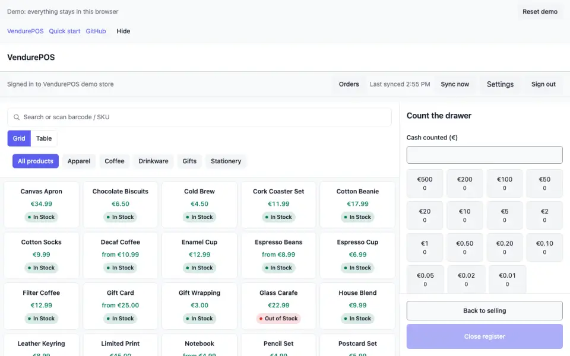 |
| — | 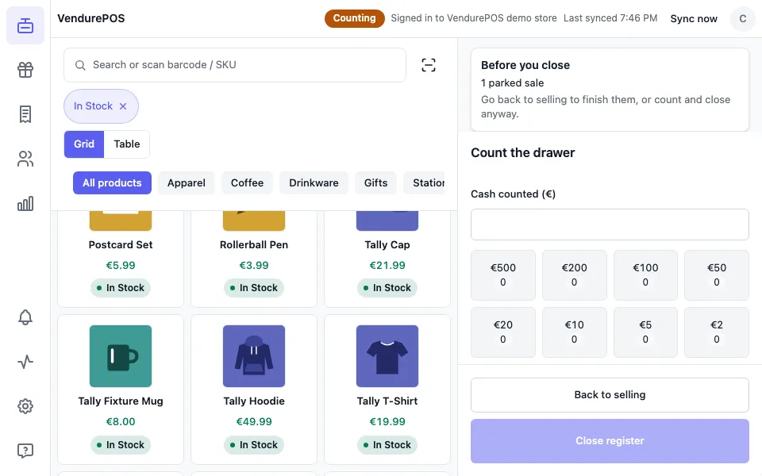 |

## 7. Orders

| WCPOS | VendurePOS |
|---|---|
| 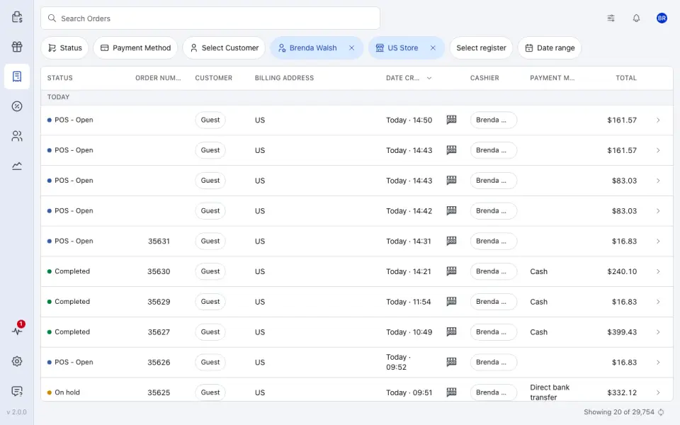 |  |
|  | 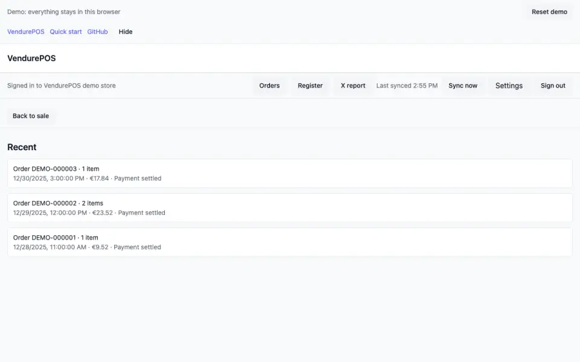 |
|  | 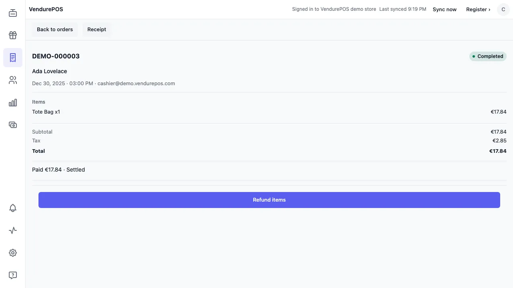 |

- [x] **7.1 Orders as a full screen from the rail.** It has a table (status, number, customer, date, cashier, payment method, total), is grouped by day, and has paging. Done (specs B14a, B14b): Orders opens on All orders, the store's orders from Vendure's own `orders` list in a table grouped by store day (status, order, customer, time, cashier, payment, total; a stacked row on a phone), 25 at a time with Show more and "Showing N of M orders". This till keeps the till's own orders with Needs attention and Retry. Demo e2e "the Orders panel lists the store's orders by day, and searches and filters them". Done (7.1b): a ↻ refresh sits right after "Showing N of M orders", as v2's 07b. It reads the first page again with the current search and filters and is disabled while the list loads (demo e2e "the Orders refresh beside the count reads the list again"; shot `demo-pairs/07b-orders-refresh-vendurepos.webp` beside 07b). *App.*
- [x] **7.2 Order search and filters:** status, payment method, customer, cashier, register, date range. Done (specs B14a, B14b): search by order code or customer surname, and TallyUI's `OrderFilterBar` pills for status, customer (searched on the store), cashier, register and date range in the store's timezone, each mapped to Vendure's `orders(options:)` filters and the plugin's `tallyCashierRef` and `tallyRegisterId` custom fields. No payment-method pill: every POS tender is stored as Vendure payment method `tally-pos` with the till's method in the payment's metadata, which Vendure's order list cannot filter on, so the pill would always mean "all". Done (7.2c): the register pill lists the store's registers by name, as v2's "Select register": the till's bound drawer first, under the name the store lists it by (the header's), then the others in list order. "This device" is used only while the list lacks the drawer, offline or before the first read (Front desk, 2026-11-20: no duplicate). Since #370 sales are stamped with that drawer, so picking it finds the till's sales (unit tests `registerFilterOptions` in `lib/register-choice.test.ts`; demo e2e "the Orders register filter lists the store's registers by name"; shot `demo-pairs/07h-orders-register-filter-vendurepos.webp` beside 07-orders). *App.*
- [x] **7.3 Order detail:** items, totals, payment, Receipt reprint. *Round 8:* the demo now answers `order(id)`, so on demo.vendurepos.com a tap on a seeded order or on a till sale opens the order sheet with its items, totals and payment (demo e2e "opens a seeded order"). *Round 9:* Receipt on the order sheet shows the stored order's receipt in the live receipt's layout, with the tendered cash and change the till recorded, and Print receipt prints it alone (demo e2e "reprints a finished sale's receipt"). *Header (7.3b):* under the order number, the customer ("Guest" with none or the walk-in), then day · time · cashier as v2's "Today · 14:31 · …", from the sale's till time in the store's timezone; the register is named only when the store lists more than one register, as 1.2 (demo e2e "the order sheet names the customer", shot 07e). *Notes (7.3c):* under the header, the order's Vendure notes oldest first, "Note: …" for a public one and "Staff note: …" for a private one, from one Admin API read of the order's ORDER_NOTE history entries; the till's ReadOrder already returns them and no new permission is asked, and a refused or failed read shows none. Notes are never on a receipt, the customer display or any print: the block carries the print-hide marker, the reprinted receipt shows neither note, and a unit test asserts the receipt payload never carries them (Front desk ruling, 2026-11-21). Demo e2e "the order sheet shows the order's notes, a private one as Staff note, never on its receipt or a print, as v2's order notes", shot `demo-pairs/07f-order-notes-vendurepos.webp`. *App.*
- [x] **7.4 Refund from the order detail.** Done in round 8: #216's refund sheet works on the demo too, because the demo store takes `order.refund` v1 under the plugin's rules (per-line shares, quantity left, split across payments, restock, expected cash). Demo e2e "refunds a mug from the order sheet".

## 8. Reports

| WCPOS | VendurePOS |
|---|---|
|  |  |
| 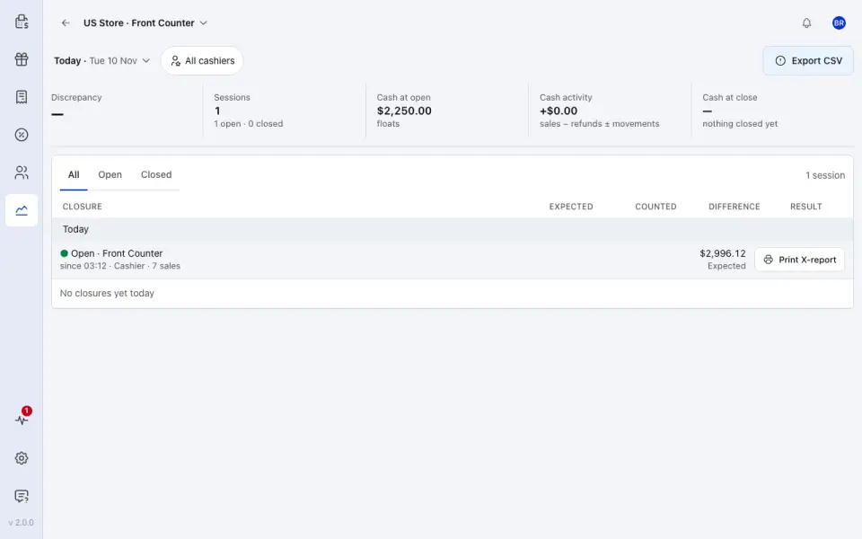 | 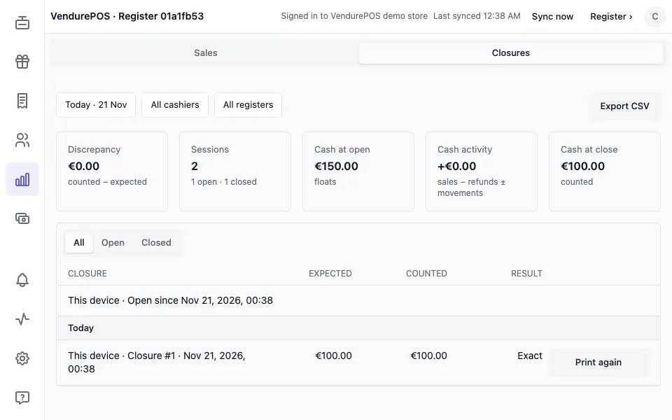 |
| — | 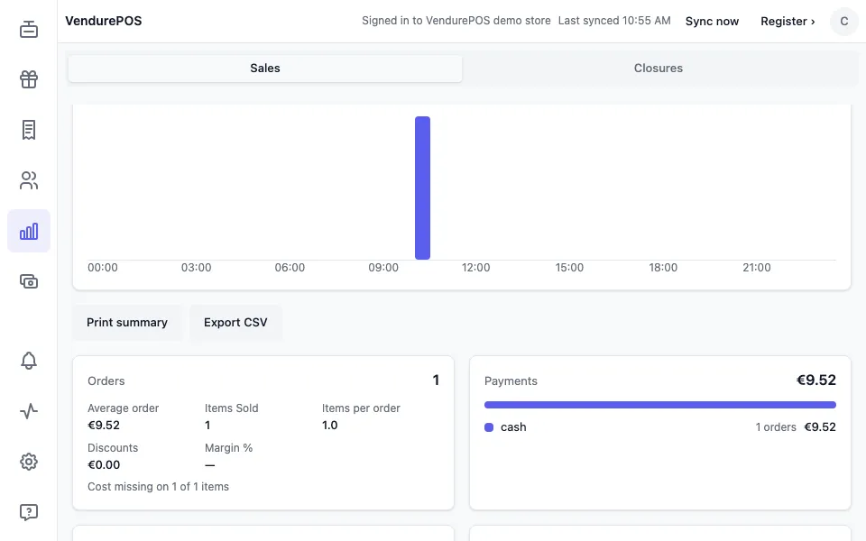 |
| — | 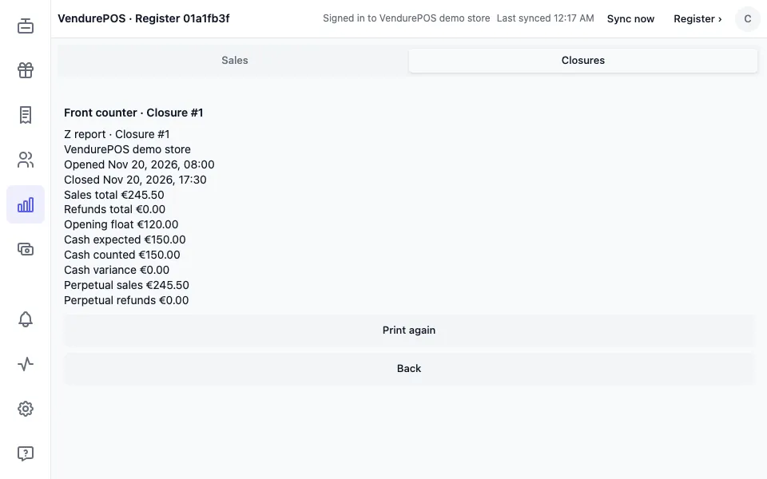 |

- [ ] **8.1 Reports screen.** It has:
  - a drawer card;
  - today's KPIs (sales, orders, average, largest, items, discounts, vs yesterday);
  - a by-hour chart, the payment-method split and top products.

  The plugin's sales report endpoint is on `main` (#213). *App:* the screen.

  Partly done (specs B13, B13b): Reports sits in the rail after Orders and opens a panel over the sale. It uses TallyUI 3.20.0's filters bar and cards around an app-local hero (`apps/pos/lib/till-sales-hero.tsx`). The panel works from this till's own sales: the local orders, without refused ones, and the applied refunds. It has:
  - the period, status, cashier and register filters;
  - the hero, as v2 has it:
    - the total, with Orders, Average order and Items beside it (under it on a phone);
    - one "⇄ vs yesterday" switcher;
    - by-hour bars for a one-day period, and day bars for longer ones;
  - the Orders card (with discounts), and the Payments, Products, Categories, Taxes and Refunds cards.

  A scan closes the panel and adds (demo e2e "Reports shows the till's sale for today").

  Round 15: the panel opens on v2's drawer card (float + cash sales = expected, Print X-report; #264), the hero shows the median and largest order (#261), and Print summary prints the period's figures (#269).

  Done (P8.1g): Reports has Sales and Closures tabs. Closures lists every register's closures of the store (8.2's list), and a row opens to its Z report with Print again and Back (demo e2e "Reports › Closures lists every register's closures and opens one to its Z report"; demo-pairs/10d beside 10b). Done (P8.1h): Closures is laid out as v2's view, with Sessions, Discrepancy and Cash at close tiles over the listed closures, All/Open/Closed tabs, each register's live session as an open row, and Expected/Counted/Result columns grouped by day (Today, Yesterday); Result words the difference ("Exact", "€5.00 short") in one column (same demo e2e; 10d retaken). Done (8.1i, #325): Sales has Export CSV beside Print summary on the web, v2's "A report opens as its paper" export: the period's summary, payments, products, categories and taxes as Section, Name, Quantity, Amount rows, amounts as plain decimals, named `sales-summary-<from>-<to>.csv` (demo e2e "Reports shows the till's sale for today" reads the download; shot `demo-pairs/10e-reports-export-vendurepos.webp`). Done (8.1k, #329): v2's Cash at open and Cash activity tiles join the Closures tiles, from each live session's float and paid in/out on the plugin's register read (#328) (same demo e2e; 10c and 10d retaken). Done (4.2x): another register's open row has Print X-report, which reads that register's live session again and prints it through the same X report as the drawer card, the plugin's void rows printed as the till's own; a register that closed meanwhile, a counting one, a signed-out session or an unreachable store each get their notice (unit tests in `lib/remote-x-report.test.ts`; the demo can open only this device, whose row offers no second X report, and the demo e2e checks that). Done (8.1l): the Sales hero has v2's By hour | Running total switch at the right of the comparison button. By day replaces By hour over a longer period. Running total draws each bar, and its comparison bar, as the sum up to that hour or day; v2 draws a line, VendurePOS keeps its bars (unit test `runningTotal` in `lib/till-reports.test.ts`; demo e2e "Reports shows the till's sale for today"; shot `demo-pairs/10f-reports-running-total-vendurepos.webp` beside 10-reports). Done (8.1m, this PR): the Z report prints v2's Refunds total after Sales total, and Perpetual sales and Perpetual refunds after the tenders, each from the closure's frozen figure and only when the closure was frozen with it, so an older closure without one prints no line rather than 0.00; nothing is recomputed at print (unit tests in `lib/z-report.test.ts`; shot `demo-pairs/10g-z-report-perpetual-vendurepos.webp`, a closed row's Z report in Closures, beside 10b).

  *Left:*
  - store-wide figures. #213's `GET /tally/v1/reports/sales` returns totals, refunds, per-method amounts and day bars only, with no items, by-hour figures, median or largest order, products, categories or taxes, and no cashier filter. The hero and cards cannot switch to it without a report v2 (*plugin*).
  - the card panels. `SalesCards` takes `onOpenCard`, but TallyUI 3.20.0 ships no card detail panel (*shared*).
- [x] **8.2 Closures history** with cash at open and close, the discrepancy, and a CSV export. VendurePOS's cashier sheet has Closures: this till's closures from the last 92 days, each with its sales and variance, and Print again. Done (#260): each row shows cash at open and cash at close (blank during a blind count), and Export CSV (web) downloads the listed closures through TallyUI 3.20.0's `exportCsv` as `closures-<today>.csv`. Done (#278): the CSV is named by the dates it lists, `closures-<oldest>-to-<newest>.csv` in the store's time zone, as in v2 (demo e2e "a closed till lists its closures and reprints a Z as a copy"). Done (P8.2d): the list and its CSV hold every register's closures of the store, each row named ("This device" or the register's device name), from the plugin's `GET /tally/v1/registers/:id`; another register's row has no cash at open, as the plugin's closure read has no breakdowns (demo e2e "a closed till lists its closures and reprints a Z as a copy"; demo-pairs/10c). Done (8.2d, this PR): Reports › Closures has v2's filter row (10b): the period (TallyUI's `DateRangeMenu`, at Today as v2), a cashier and a register select, and Export CSV at the top; the rows, the tiles, the CSV and its file name follow the filters, and open sessions are listed whatever the period and the cashier (register filter only); the cashier sheet's Closures list keeps every closure of 92 days (demo e2e "Reports › Closures lists every register's closures and opens one to its Z report"; demo-pairs/10d retaken). *App.*

## 9. Settings and look

| WCPOS | VendurePOS |
|---|---|
| 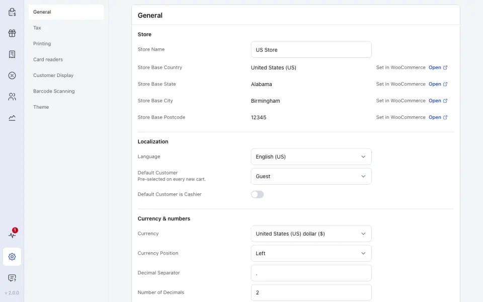 | 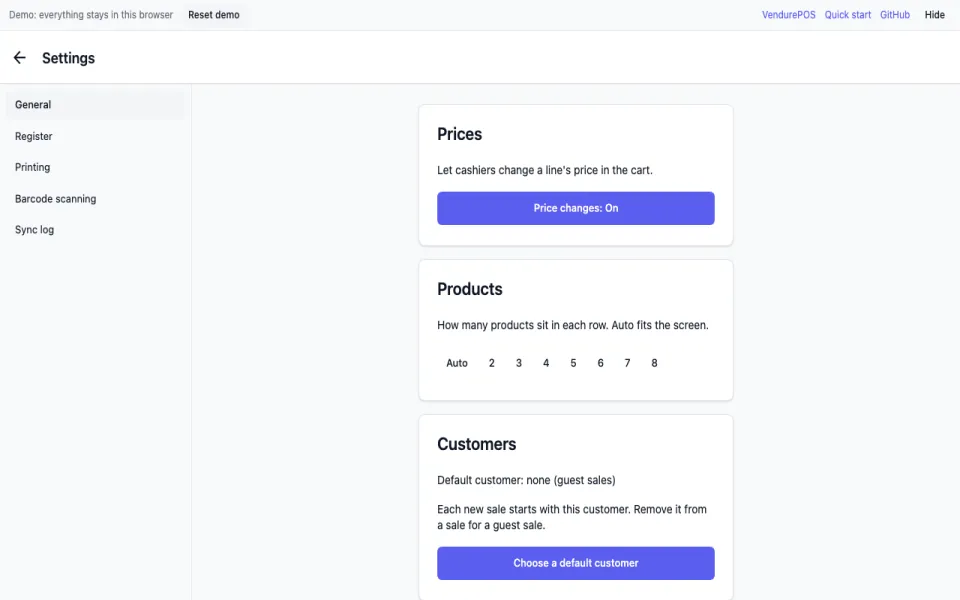 |
| 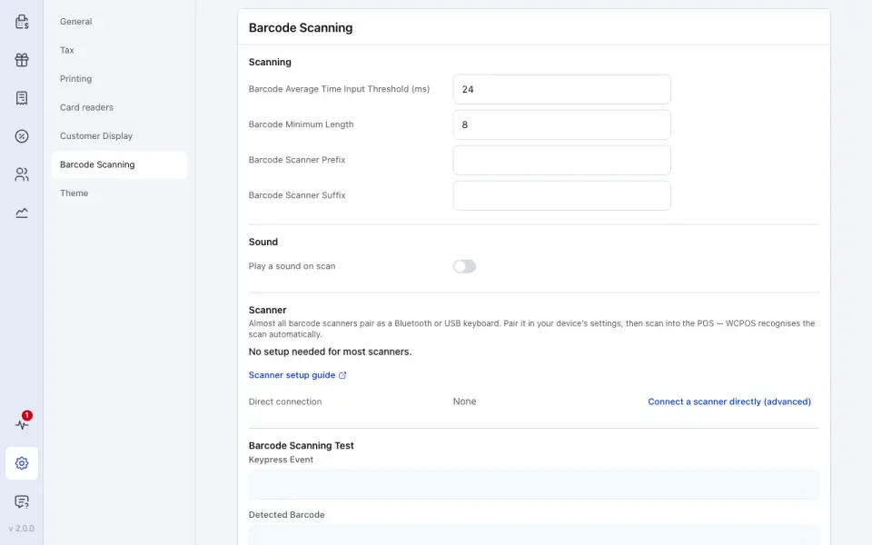 |  |
| 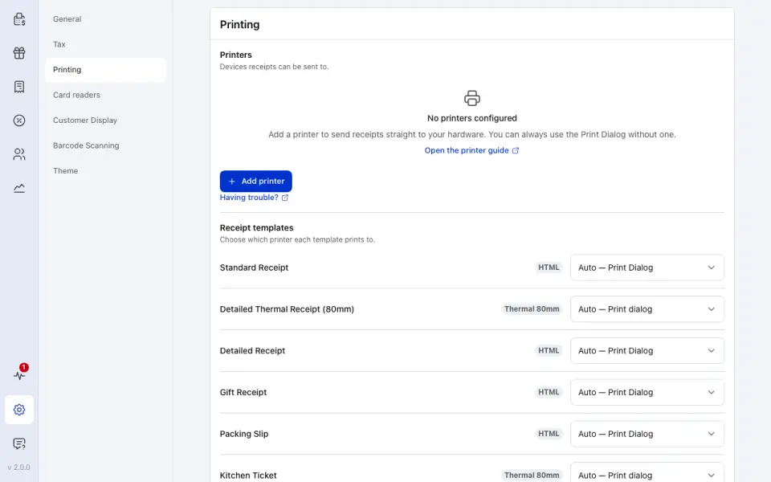 | 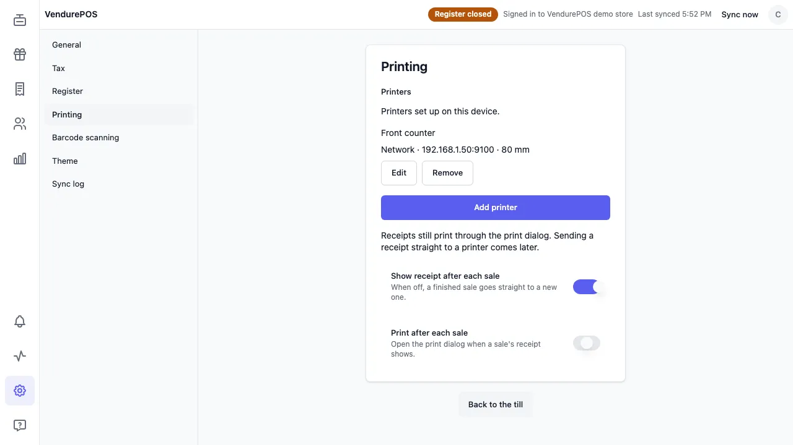 |
|  | 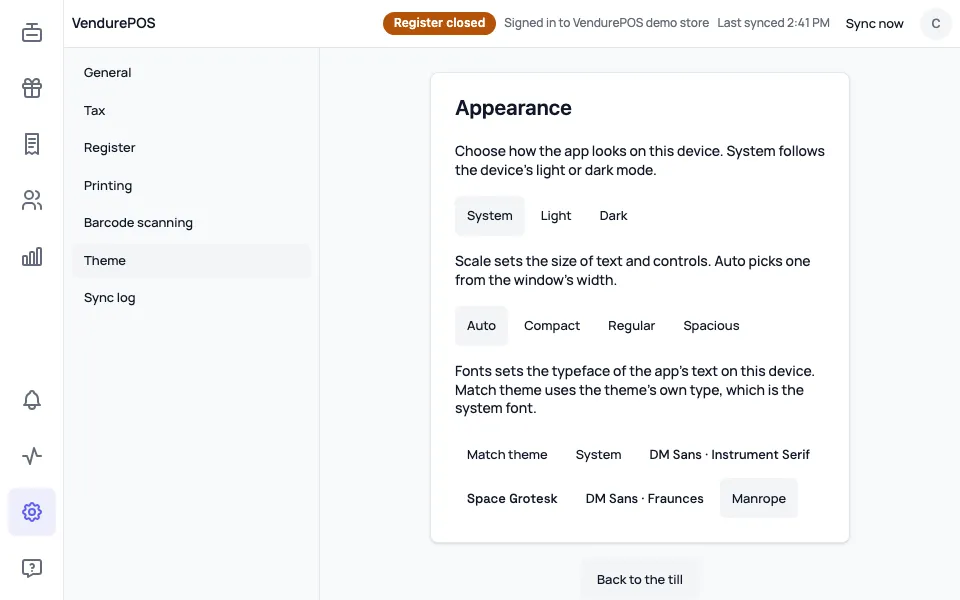 |

- [ ] **9.1 Tabbed settings area.** The tabs are General, Tax, Printing, Card readers, Customer display, Barcode and Theme. *Shared:* `SettingsLayout` exists in 3.12.0. *App:* adopt it. Done (specs B16a, B16b): Settings is TallyUI's `SettingsLayout`, a list of sections (General, Register, Printing on the web, Barcode scanning, Theme, Sync log) with only the chosen section beside it, General first; the chosen section is `aria-selected`. On/off settings (Price changes, Print after each sale, Scan sounds) are a label row with a switch, as v2 (spec B17). Below 768 px the list stacks behind Menu/Done. Demo e2e "Settings shows one section at a time, General first, and stacks behind Menu at phone width". Done (#285): the rail's Settings opens a panel in the till frame, like Orders and Reports, with the rail beside it and Settings lit; the till takes changed settings when it closes, and a scan there adds nothing to the sale (demo e2e "Settings opens beside the rail, and a scan there adds nothing to the sale"). *Left:* on a phone, `SettingsLayout` keeps the list open after a pick until Done (*shared*). Tax, Card readers and Customer display have their own rows (9.6–9.8).
- [x] **9.2 Theme: System / Light / Dark, plus Scale.** *Shared* theme tokens, *app* settings. Theme done (specs B18a–B18a4): Settings › Theme picks System, Light or Dark (TallyUI's `UI_THEMES`). The choice is saved on this device (the app's key-value store, as v2 keeps it per device), applied through Uniwind, and applied again at start-up before any screen renders; System follows the device (#210). Demo e2e "Settings › Theme chooses Light or Dark over the device's scheme, and keeps it after a reload". Scale done (spec B18b): the same card picks Auto, Compact, Regular or Spacious (TallyUI's `UI_SCALES`), saved on this device and fed to TallyUI's `ScaleProvider` at the root (Uniwind's `ScopedVariables` on native). Auto, the default as in v2, is Compact under 640 px wide and Spacious from 1600 px; before this the till was always Regular. Demo e2e "Settings › Theme sets the scale, and keeps it after a reload". Phone tap-target sizes at Compact and Regular are in [tap-targets.md](tap-targets.md): under 44 px at both, a TallyUI matter. Fonts done (9.2c, this PR): the same card offers v2's six choices (Match theme, System, DM Sans · Instrument Serif, Space Grotesk, DM Sans · Fraunces, Manrope), each label previewed in its own face. The choice is saved on this device (`lib/font-setting.ts`) and fed to TallyUI's `FontProvider` at the root. The app bundles TallyUI's 20 faces from `@expo-google-fonts` (OFL-1.1) and registers each weight on the web with the `FontFace` API (`lib/app-fonts.ts`), loading them only when the Theme card opens or a type set is chosen. Demo e2e "Settings › Theme sets the fonts from the bundled faces, and keeps the choice after a reload" checks all 20 faces load. Shot 11 refreshed. *Left:* v2's named themes beyond light and dark and v2's icon families need `@tallyui/theme` first; on native the status bar follows the choice (9.2b, `lib/status-bar-style.ts`, unit test; a device shot is owed in #319).
- [ ] **9.3 Language.** *Left:* all of it. TallyUI 3.20.0 has an `I18nProvider` with English only; other languages, the app's own strings and a Language setting are missing. *Shared + app.*
- [x] **9.4 Barcode settings with a test area.** Done (spec B10): Settings › Scanner ends with v2's "Barcode scanning test": the last key the scanner sent with its gap in ms, and the code detected after the prefix, suffix and shortest length, with the scan sound as set (web). A scan on Settings no longer adds to the sale hidden under it (demo e2e "Settings' barcode test"). v2's average-time threshold is not a setting: the 24 ms key gap is fixed in code (`WEDGE_KEY_GAP_MS`), and the test area shows each key's gap against it. Direct connection (9.4b, #354): the same section connects a USB HID-POS scanner (WebHID) or a USB serial scanner (Web Serial) through TallyUI's `ScanHubProvider`, keeps it on this device (`lib/scanner-profiles.ts`) and reopens it at start-up; Disconnect forgets it. Its scans go through the till's `onScan`, and a wedge copy of the same code within 500 ms is dropped (`lib/device-scanner.ts`). Browsers without either API show a plain fallback (demo e2e "Settings › Barcode scanning offers a direct connection…", "a scanner connected directly over HID-POS…" with a fake device, "a browser without WebHID or Web Serial…"). Not proven on a real scanner: the proof is the browser's own chooser opening and a faked HID-POS report. Shot 11 refreshed. *App.*
- [ ] **9.5 Printing: printers and receipt templates.** VendurePOS has "Print after each sale". Printers done (9.5a, #359): Settings › Printing lists the printers set up on this device. Each has a name, a connection (Network, Bluetooth or USB), an address (and a port for Network) and a paper width (58 or 80 mm). They are kept as TallyUI's `PrinterProfile` in the device store (`lib/printer-profiles.ts`), and can be added, edited and removed (demo e2e "Settings › Printing adds, edits and removes a printer kept on this device"; shot 11). Data only: receipts still print through the print dialog. *Left:* sending a receipt to a saved printer (TallyUI's ESC/POS transport) and receipt templates mapped to printers, as v2 does. *Shared + app.*
- [x] **9.6 Tax display options and "Tax based on: shop base / customer".** Done Vendure's way (#263): Settings › Tax, after General, is read-only, because in Vendure tax is not a till setting. It shows whether the channel's prices include tax, "Tax based on: the channel's default tax zone", one row per tax category with its rate, and where to change them in the Vendure admin. TallyUI 3.20.0's `TaxCalculationSettings` is not used: it holds WooCommerce's choices. *App.*
- [ ] **9.7 Card readers.** *Shared + plugin,* Vendure way.
- [x] **9.8 Customer display pairing.** *Plugin + app.* Done (P9.8a-c, #300, #304-#307): the plugin implements TallyUI ADR-085's display signalling (per-till check codes, claim limits); Settings › Customer display mints a pairing code and lists and forgets displays; the `/display` route pairs a second screen and shows the till's sale (dev-store e2e "Settings › Customer display mints a pairing code on the dev store" and "a customer display pairs on a second page, shows the till's cart, and a forget sends it back to pairing"). The demo build has no customer display (demo e2e "the demo build has no customer display: /display lands on /"). v2's merchant display templates (Templates › Display) are not part of this row.
- [ ] **9.9 Product-grid settings sheet:** tile fields, browse by, sort, show out-of-stock. VendurePOS has Grid / Table and products per row, and Settings › General › "Show out-of-stock products" (#268). Done (#276): Settings › General › Products has "Sort products by" (Name A–Z, the default; Price low–high; Price high–low; Stock high–low), kept for this till and fed to `Catalogue`'s sort (demo e2e "Settings keeps the product sort for this till, and the grid takes it on return"). The product pane's status row has v2's sliders button before Grid / Table, which opens Settings › General scrolled to the Products card; the cart header's sliders still jump to the Cart card and the rail's Settings opens at the top (9.9c, this PR, demo e2e "the product pane's settings button opens Settings › General at the Products card, as v2's product settings (02f)", shots 02f-product-settings-entry and 02f-product-settings-jump beside 02f-sell-product-settings-wcpos). *Left:* tile fields (*shared:* no prop); browse by and Variations follow 1.5 and 4.1.
- [ ] **9.10 Cart settings:** panel side, open-orders position, columns, quick-discount presets, auto-show and auto-print receipt. VendurePOS has "Print after each sale", and Settings › General sets the price keypad's quick-discount presets (#267). Done: Settings › General puts the cart on the left or the right on wide screens (#274, demo e2e "Settings › General puts the cart on the left or the right of the till") and the open orders at the top or the foot of the cart (#279, demo e2e "Settings › General puts the open orders at the top or the foot of the cart"); Settings › Printing (web) can turn off the receipt after each sale, which then ends on an empty cart with a "Sale complete" toast (#272, demo e2e "with the receipt after each sale off, a cash sale ends on an empty cart, and on again shows the receipt"). Settings › General › Cart › Columns shows or hides Qty (with Split), Image, Name (with the SKU under it), SKU, Price and Total on this device, and Split splits a line of quantity 2 or more (#357, demo e2e "Settings › General › Cart columns show an item's image and SKU, and Split splits a line", shots 04l). Settings › General › Cart › Sort items puts the newest or the oldest line at the top of the cart on this device, oldest by default; fees and shipping stay last (9.10f, this PR, demo e2e "Settings › General › Cart sorts the items newest or oldest at top", shot 04h-cart-sort). Settings › General › Restore default cart settings, after a confirm, puts the cart's side, sort, columns and open orders, the quick discounts and Printing's show and print after each sale back to their defaults on this device (9.10g, this PR, demo e2e "Settings › General › Restore default cart settings puts every cart setting back, after a confirm", shot 04h-cart-restore). The cart header's Customer row ends with v2's sliders button, which opens Settings › General scrolled to the Cart card; the rail's Settings still opens at the top (9.10h, this PR, demo e2e "the cart header's settings button opens Settings › General at the Cart card, as v2's cart settings (04h)", shots 04h-cart-settings-entry and 04h-cart-settings-jump). *Left:* column drag order. At the top, `OpenSaleTabs` keeps its upper border and takes no className (*shared*).

## 10. Back office

| WCPOS | VendurePOS |
|---|---|
| 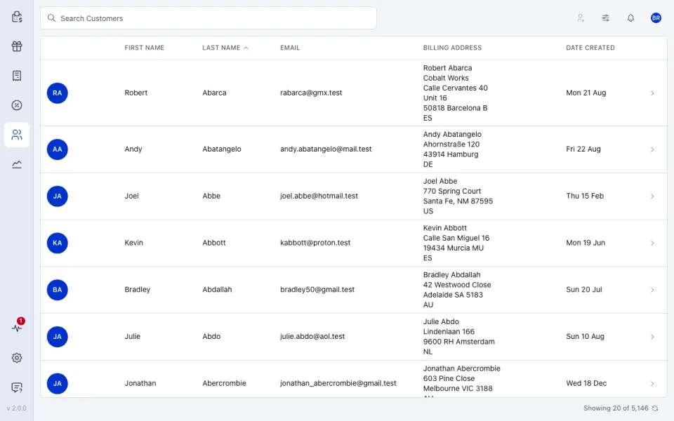 | 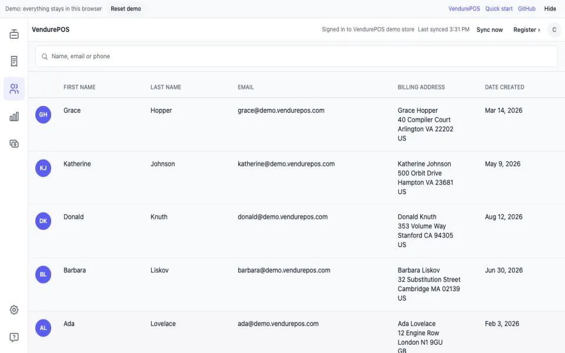 |
|  | 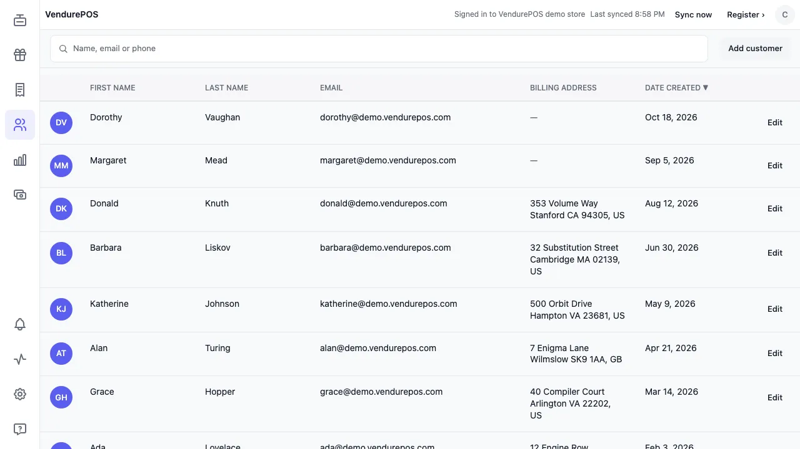 |
| 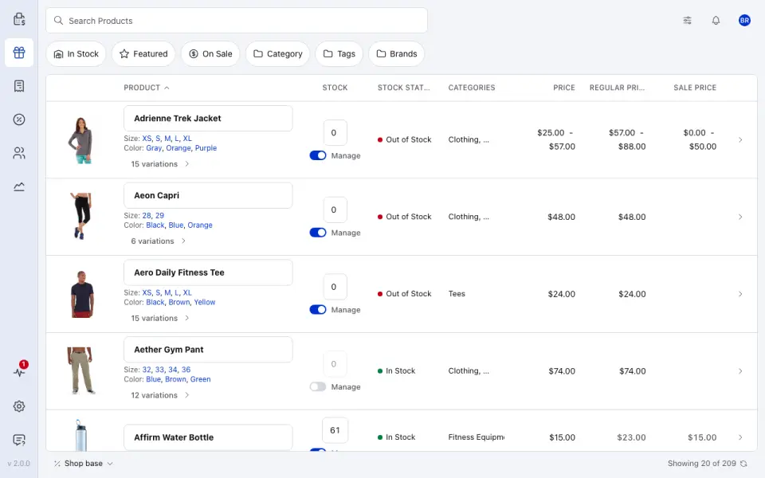 | 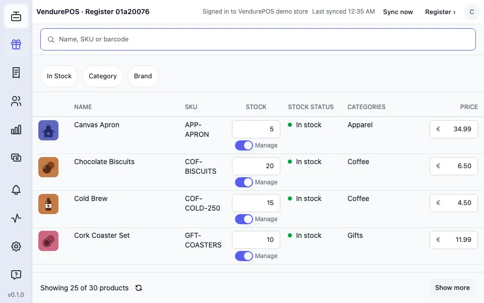 |
|  | 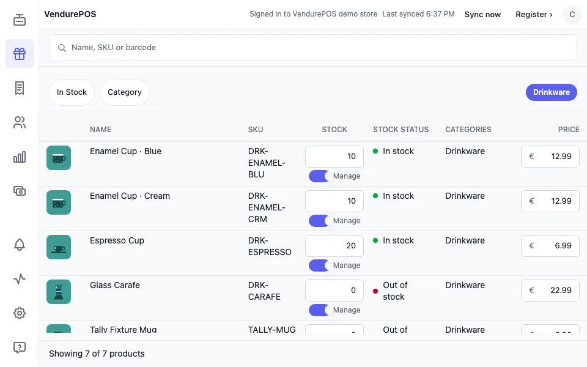 |
|  | 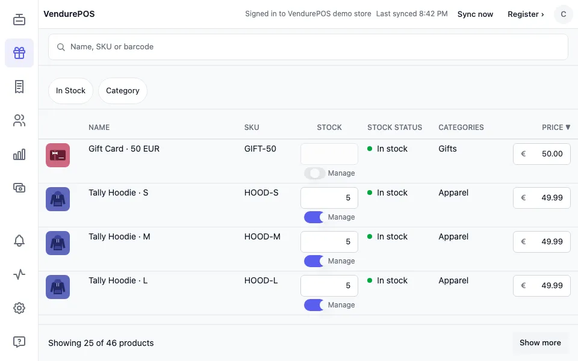 |
|  | 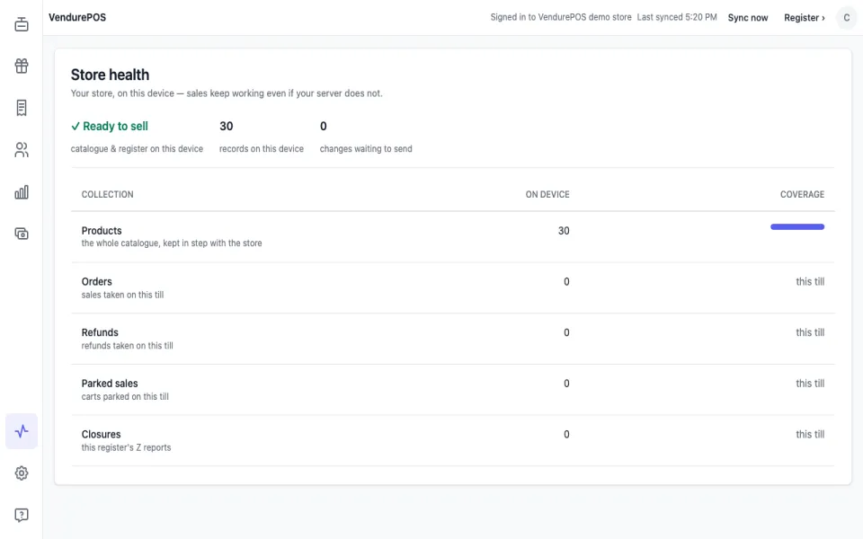 |

- [ ] **10.1 Customers screen:** list, search, edit. List and search done (specs B15a, B15b, B15b2): a Customers door between Orders and Reports opens the store's customers from Vendure's `customers` list, by surname, in v2's table (avatar, first and last name, email, default billing address, date created; a stacked row on a phone), 25 at a time with Show more and "Showing N of M customers", searched by name, email or phone. The walk-in customer is left out. A scan closes the panel and adds. Demo e2e "the Customers panel lists the store's customers by surname, searches them, and a scan closes it and adds". The door shows only to a role that can read customers (spec B15d, #246), and the billing address is two lines, as v2 (spec B15e, #247). Add and edit done (spec 10.1c, #356): an Add customer button and an Edit button on each row open v2's right-hand "Edit <name>" sheet with first and last name, email and phone. A save goes straight to Vendure (`createCustomer`, or `updateCustomer` with only the changed fields) and the list re-reads from the store, so a refusal such as a taken email shows the store's reason and leaves the row as the store has it. Offline, Save is blocked rather than queued. Add shows only to a role with Create customer and Edit only to one with Update customer; the plugin's till role holds Update customer and never Delete customer (#358; an existing role gains it at the next New POS till key). Demo e2e "the Customers panel adds and edits customers on the store; a refused save leaves the row as the store has it" and smoke on the dev store; shot 06d. Header sort done (10.1d, this PR): First name, Last name, Email and Date created sort from their headers, by the store (Vendure's `CustomerSortParameter`), so every page follows the sort. It opens on Last name ▲ as v2's "LAST NAME ^"; a press on the sorted column flips it, a press on another sorts that one ascending, and the list reloads from its first page. Search, Show more and the reload after a save keep the sort. The phone layout has no header and keeps Last name ▲. Demo e2e "the Customers panel sorts by its headers on the store, as v2's customers table"; shot 06e. *Left:* billing and shipping addresses, company, tax IDs and custom fields in the sheet, which wait on the shared TallyUI address editor (5.2, *shared*), and no delete. *Shared* then *app.*
- [ ] **10.2 Products screen:** stock and price edited inline, with a manage-stock switch. *Plugin + app.* Done (#281): a Products door after POS opens a panel over the sale with TallyUI's `ProductTable` (Name, SKU, Price, Stock), one row per variant from the local catalogue, searched like the till, 25 at a time with Show more and "Showing N of M products"; a scan closes it and adds (demo e2e "the Products panel lists the catalogue's variants with SKU, price and stock, searches them, and a scan closes it and adds"). Done (#286): a single-variant product's price and stock are edited inline, with a Manage switch, for an administrator with `UpdateCatalog` or `UpdateProduct`. The price is offered only when the till's currency and tax mode are the channel's. A stock write re-reads the store and refuses when the saleable figure moved since the sync. The Manage switch shows the effective setting (a variant on INHERIT follows the store's Track inventory), and a flip writes TRUE or FALSE, so that variant stops following the store's setting. Done (#342 and this PR): a stock write is one compare-and-set call to the plugin's `POST /tally/v1/variants/:id/stock`, under the sale's stock lock, so a sale between the read and the write is refused, never overwritten; a plugin without the route answers 404 with no code, and the till falls back to the re-read and write (the demo takes that path). Done (10.2e, this PR): each variant row of a multi-variant product edits its own price, stock and Manage switch the same way, through the same per-variant writes (demo e2e "the Products panel edits one variant of a multi-variant product, and its sibling keeps its price and stock", shot `demo-pairs/08e-products-variant-edit-vendurepos.webp`). Done (10.2f, this PR): v2's other display columns. The columns are now Image (the product's featured asset, no head label), Name, SKU, Stock, Stock status (a coloured dot with In stock, Out of stock or On backorder, from the variant's own stock level) and Categories (the product's Vendure collections), then Price. Demo e2e "the Products panel shows each variant's image, stock status and categories, as v2's products table"; shot `demo-pairs/08-products-vendurepos.webp` refreshed. Regular and Sale price stay out (2.5 ruling). *Left:* v2's grouped "N variations" row (*shared:* `ProductTable` rows are per product) Done (10.2g, this PR): v2's filter pills In Stock and Category above the table (TallyUI's `ProductFilterBar`). In Stock starts off, as on v2's Products screen, and hides out-of-stock rows; Category opens the store's collections and lists only the picked one, shown as a chip that clears it. Featured, On sale, Tags and Brands are left out (no Vendure field). Demo e2e "the Products panel filters by In Stock and by category, as v2's filter pills", shot `demo-pairs/08f-products-filters-vendurepos.webp`. Done (10.2h, this PR): v2's sortable headers (its "PRODUCT ^"). Name, SKU, Stock and Price sort through TallyUI's `ProductTable` sort and `sortProducts`; a press goes ascending ▲, descending ▼, then back to the store's order. The panel sorts the whole filtered list before its 25-row page, so a product from page two can come first (Name ▼ brings the last row, Weekly Planner, to the top); a missing SKU, stock or price sorts last. Image, Stock status and Categories stay unsortable. Demo e2e "the Products panel sorts by its headers, across every page, as v2's products table", shot `demo-pairs/08g-products-header-sort-vendurepos.webp`.
- [x] **10.3 Store health:** "Ready to sell", changes waiting to send, records that need attention (Fix / Retry), per-collection coverage. VendurePOS has Settings › Sync log and "Last synced / Sync now". *App.* Done (#273, #280): a Store health door at the rail's foot opens a panel with "Ready to sell" (or the first reason it is not), records on this device, changes waiting to send, and a table of on-device counts for Products, Orders, Refunds, Parked sales and Closures (demo e2e "Store health shows Ready to sell, nothing waiting and the products on this device, and a scan closes it and adds"). Records that need attention list as reference · total — reason, with Open (into the Orders panel) and, where the Orders panel offers it, Retry (unit tests only: the demo has no refused sale). Done (#290): an On server column and coverage against the store's own totals. Done (P10.3e): v2's View log › once per attention callout, opening Settings › Sync log, where the refusal is logged with the order's id (smoke e2e "a rejected sale needs attention…"; shot `demo-pairs/13f-store-health-view-log-vendurepos.webp`). Done (P10.3d, desk ruling 2026-11-18): v2's Fix record. The record's Open now reads Fix record, and the refused sale's sheet shows the store's reason with a primary Retry that resends it and returns to the list (smoke e2e "Store health's Fix record…"; shot `demo-pairs/13g-store-health-fix-record-vendurepos.webp`). Editing a refused sale in the cart is not built (backlog, one-way). Done (10.3b, #324): "Check everything now" at the panel's foot, and the Products row's "Clear & re-download" (a confirm, then the catalogue database is removed and downloads again; sales, refunds, parked carts and closures are kept), as v2's Database tab (demo e2e "Store health checks everything now, and Clear & re-download empties and refills the products and the till still sells"). Clear & re-download is off until the store answers, and asks the store again on Yes; a till that cannot reach it, or a Cancel during that check, keeps its catalogue (unit tests). Done (10.3f): v2's drawer badge. The rail's Store health item counts the errors the sync log has kept since it was last open, warnings never; opening Settings › Sync log clears it, and the count starts at 0 when the app opens (smoke e2e "a store error badges Store health…"; shot `demo-pairs/13h-store-health-error-badge-vendurepos.webp`). Done (10.3g): v2's storage used and "N stuck". On the web the header shows the browser's storage estimate for this origin beside the record count (native shows none: there is no equivalent call), and the Orders row carries a red "N stuck" chip counting the records that need attention (demo e2e "Store health shows Ready to sell…", smoke e2e "a rejected sale needs attention…"; shot `demo-pairs/13i-store-health-stuck-vendurepos.webp` beside v2's 13d, and 13f now shows the storage stat). Done (10.3i, #355, desk ruling 2026-11-20, recorded as a chosen addition over v2): a Sync cadence card under Store health offers Standard (the unchanged default: a re-pull every 60 s with the adapter's page of up to 100), TallyUI's Eco, Balanced and Realtime presets, and Custom clamped to TallyUI's limits (5 s to 5 min, 10 to 100 records). The choice is kept on this device; a new interval applies at once, a new page size at the next start (unit tests; demo e2e "Store health › Sync cadence keeps this till's choice…"; shot `demo-pairs/13j-store-health-sync-cadence-vendurepos.webp`, VendurePOS only). Done (10.3k, this PR): Settings › Sync log's filters are v2's Logs presets, All, Actions and Errors, through TallyUI 3.20.0's `presetFilters` / `matchesPresetFilters` (Errors is errors only; the old "Warnings and errors" is gone, as in v2). The log keeps each entry's actor (id and name only), so Actions lists what a person did (register opened or closed, pay in or out, X-report), and an action shows who did it on screen; the Copy/Share text is unchanged and never carries the actor (unit tests; demo e2e "the sync log's Actions preset shows what the cashier did, and Errors hides it"; shot `demo-pairs/13k-store-health-log-presets-vendurepos.webp`, VendurePOS only). *Left:* v2's per-collection Size column.
- N/A **10.4 Coupons screen.** Vendure promotions are managed in the Vendure admin (`AUDIT.md` §19). A coupon-code field in the cart is a separate row once one is found in WCPOS's cart.

## 11. Rarely seen

| WCPOS | VendurePOS |
|---|---|
|  | 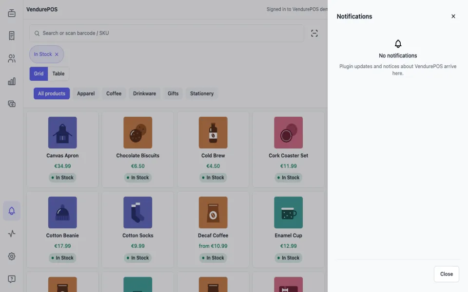 |

- [x] **11.1 Notifications bell and inbox.** *App.* Done (#282): a Notifications door at the rail's foot, badged with the count, opens v2's side sheet: the till's notices, or "No notifications" and Close. The one source, Vendure's way, is the store's VendurePOS plugin being older than the app needs for sales, charges or the register (demo e2e "Notifications at the foot of the rail shows the empty state and closes"). The sheet's foot links "About notifications" to vendurepos.com/docs/notifications (11.1b, same demo e2e). Chosen difference from v2 (11.1c, Front desk 2026-11-20): the bell stays at the rail's foot rather than in the header, so every door to a panel sits on the rail and the header stays one slim row.
- [x] **11.2 Support entry in the rail.** *App:* for VendurePOS, docs and GitHub links in place of a chat widget. Done (spec B11): Support sits at the foot of the rail under Settings (in the drawer on phones) and opens a side sheet with the quick-start guide, "Report a problem on GitHub" and the app version; a scan closes it and adds, as for the Orders panel (demo e2e "Support at the foot of the rail").
- N/A **11.3 Sign-in page.** WCPOS uses the store's WordPress login; VendurePOS has its own sign-in and a demo landing page. Neither is a POS screen to match.

---

## Rounds

| Round | Date | Score | Moved |
|---|---|---|---|
| 1 | 2026-11-10 | 3 / 56 | Baseline. |
| 2 | 2026-11-12 | 4 / 56 | B1 frame: 1.2. |
| 3 | 2026-11-12 | 6 / 56 | B2 cart: 1.4, 2.4. |
| 4 | 2026-11-12 | 9 / 56 | B3 checkout: 2.2, 3.3, 3.4; 3.1 and 3.2 mostly done. |
| 5 | 2026-11-12 | 11 / 56 | B4 cart lines: 2.7, 2.8. |
| 6 | 2026-11-12 | 12 / 56 | B5 close during a tender: 6.4 (a regression test; the fix came with TallyUI 3.19.0). |
| 7 | 2026-11-12 | 14 / 56 | B6 camera scan: 1.7; 1.3 checked on the demo and already at parity (TallyUI 3.20.0). |
| 8 | 2026-11-12 | 15 / 56 | B7 demo orders: 7.4; 7.3 opens on the demo, receipt reprint still missing. |
| 9 | 2026-11-12 | 16 / 56 | B8 receipt reprint: 7.3. |
| 10 | 2026-11-12 | 18 / 56 | B9 cart header: 2.3 customer chip, 2.12 add toast; the address pin moves to 5.2. |
| 11 | 2026-11-12 | 19 / 56 | B10 Settings: 9.4 barcode scanning test; the till's scanner listens only while the till is in front. |
| 12 | 2026-11-12 | 20 / 56 | B11 rail: 11.2 Support with the quick start, GitHub issues and the version. |
| 13 | 2026-11-12 | 21 / 56 | B12 register: 6.2 the panel is v2's side sheet with the session header and Print X-report. |
| 14 | 2026-11-17 | 24 / 56 | refresh: no new ticks; the score recounted (7.1, 7.2 and 9.2 were ticked after round 13); 1.2's banner line fixed (#256); retagged 1.5, 1.8, 1.9, 2.5, 2.10, 4.1, 5.1, 6.3 to shared, 2.1 and 8.2 to app, 3.2 and 5.2 to shared + plugin, 9.8 to plugin + app. |
| 15 | 2026-11-17 | 27 / 56 | 2.1 open sales as tabs (#259), 8.2 closures cash and CSV (#260), 9.6 read-only Tax (#263). Parts done in 1.6 (#258), 2.11 (#265), 3.1 (#266), 6.1 (#262), 8.1 (#261, #264, #269), 9.9 (#268), 9.10 (#267); 8.1's store-wide figures retagged to plugin, its card panels to shared. |
| 16 | 2026-11-17 | 27 / 56 | No new ticks. Parts done in 1.1 (#273, #281, #282), 6.1 (#271), 8.2 (#278), 9.1 (#285), 9.9 (#276), 9.10 (#272, #274, #279), 10.2 (#281), 10.3 (#273, #280), 11.1 (#282); 10.3 stays open on coverage against the store, Fix record and View log (app). |
| 17 | 2026-11-18 | 30 / 56 | New ticks: 6.1 (#277, #297 P6.1e), 6.6 (#283, #291, #294, #296, #297), 10.3 (#290 coverage, #308 View log, #309 Fix record). Parts done in 2.11 (#284 customer note); 2.11 stays open on tax exempt (shared + plugin). |
| 18 | 2026-11-18 | 31 / 56 | 3.1 checkout (the Split chip, #275, #292, #293, #295). |
| 19 | 2026-11-19 | 32 / 56 | New tick: 9.8 customer display pairing (#300, #304-#307; the row still read plugin-blocked). Parts done in 1.7 (#321 native camera, device proof owed in #319), 9.2 (#320 native status bar, device shot owed in #319), 11.1 (#322 About notifications link). |
| 20 | 2026-11-19 | 32 / 56 | No new ticks. Parts done in 8.1 (#325 Sales Export CSV; the 10b closures pair now shows 10d) and 10.3 (#324 Check everything now, Clear & re-download, already ticked). 8.1 stays open on store-wide figures, card panels, Cash at open and another register's X-report (plugin and shared). |
| 21 | 2026-11-20 | 32 / 56 | No new ticks. Done since round 20: 8.1's Cash at open (#329) and another register's X report (#331, 4.2x). Outside the 56 rows: the needs-admin page names each sale's channel (#338), and the manager approval sheet is done (#339; the store setting waits on TallyUI/tallyui#1105). AUDIT.md's build list is reconciled: all 13 items shipped. Every open row's *Left:* waits on TallyUI or a ruling. |
